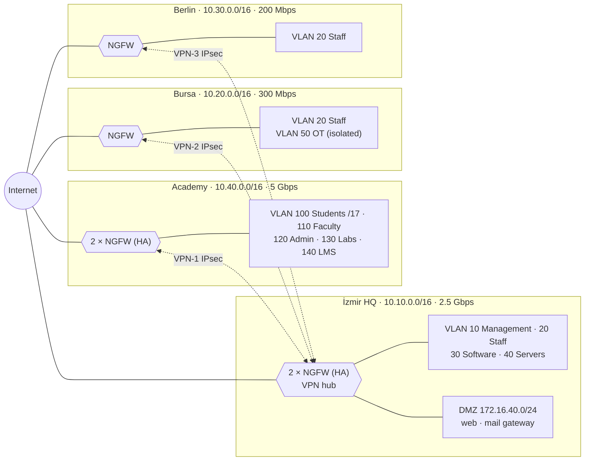
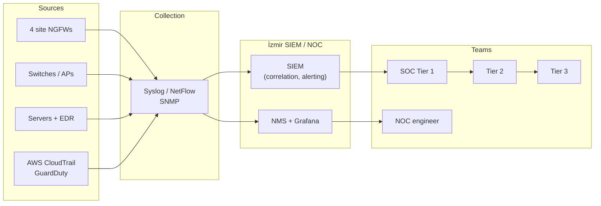

# AnadoluNet Technology Holding

> Contributed by `B*** Ö***` ([@Pireburak](https://github.com/Pireburak)) · BGT207 Güvenlik Duvarı Çözümleri · 2026-2027 Güz midterm project.
> Student names are masked on purpose. Converted to `company.json` from the student's own README and `config/` files; the runnable nftables/tc lab of the original repository is not included here.

## 1. Scenario: AnadoluNet Technology Holding

Our fictional company, AnadoluNet Technology Holding, consists of its İzmir headquarters, offices in Bursa and Berlin, and an academy campus in Eskişehir. It has roughly 9,100 users in total, 8,000 of whom are students at the academy. Goal: assign bandwidth to each unit based on its needs and protect all sites with a single, unified security policy.

| Unit | Location | Users | Notes |
| --- | --- | --- | --- |
| Headquarters | İzmir | 300 staff | Hosts the data center and the main firewall |
| Software (R&D) Team | İzmir, separate floor | 80 developers | Git, CI/CD, test servers; high traffic |
| Bursa Office | Bursa | 120 staff | Sales + small production line (OT devices) |
| Berlin Office | Germany | 60 staff | European sales; subject to GDPR |
| AnadoluNet Academy | Eskişehir | 8,000 students, 350 faculty, 200 administrative staff | LMS, online exams, labs, campus Wi-Fi |

Key assumptions: every site has its own internet uplink, sites are interconnected via encrypted VPN tunnels, and central servers (ERP, email, LMS backup) are accessed from İzmir.

## 2. Network Topology and VLAN / IP Plan

The architecture follows a hub-and-spoke (star) model: İzmir is the hub, and the other three sites connect to İzmir via site-to-site IPsec VPN. Each site is assigned its own /16 block, which makes it easy to write rules and routes per site.



Because inter-site traffic passes through the İzmir firewall, it is inspected at a single point.

| Site | Block | VLAN | Network | Purpose |
| --- | --- | --- | --- | --- |
| İzmir | 10.10.0.0/16 | 10 | 10.10.10.0/24 | Management (firewall, switch, server management) |
| İzmir |  | 20 | 10.10.20.0/23 | Staff |
| İzmir |  | 30 | 10.10.30.0/24 | Software team |
| İzmir |  | 40 | 10.10.40.0/24 | Internal servers (ERP, AD, email) |
| İzmir |  | DMZ | 172.16.40.0/24 | Website, mail gateway (internet-facing) |
| Bursa | 10.20.0.0/16 | 20 | 10.20.20.0/24 | Staff |
| Bursa |  | 50 | 10.20.50.0/24 | Production / OT devices (isolated) |
| Berlin | 10.30.0.0/16 | 20 | 10.30.20.0/24 | Staff |
| Academy | 10.40.0.0/16 | 100 | 10.40.0.0/17 | Student Wi-Fi (32,766 addresses: 8,000 students × \~2 devices + headroom) |
| Academy |  | 110 | 10.40.128.0/22 | Faculty |
| Academy |  | 120 | 10.40.132.0/23 | Administrative staff |
| Academy |  | 130 | 10.40.136.0/22 | Computer labs |
| Academy |  | 140 | 10.40.140.0/24 | LMS, exam and campus servers |
| All sites |  | 99 | 192.168.99.0/24 | Guest network (internet only) |

Why a /17 for students: each of the 8,000 students connects with a phone and a laptop on average, which comes to about 16,000 devices. A /18 (16,382 addresses) would be cutting it too close, so the next larger block was chosen.

## 3. Bandwidth Calculation and Allocation

The Academy has the largest requirement at 5 Gbps; İzmir gets 2.5 Gbps, Bursa 300 Mbps, and Berlin 200 Mbps. The following formula was used for each group, with a 25% growth/peak margin added to the result:

```latex
B_{total} = \left( \sum_i U_i \times C_i \times S_i \right) \times 1.25
```

Where U = number of users, C = concurrency ratio (share of users active at the same time), S = average per-user speed (Mbps).

| Site / Group | Calculation | Result |
| --- | --- | --- |
| İzmir – Staff | 300 × 70% × 2 Mbps | 420 Mbps |
| İzmir – Software team | 80 × 90% × 10 Mbps | 720 Mbps |
| İzmir – Servers + VPN hub traffic | fixed estimate | 500 Mbps |
| **İzmir total** | 1,640 × 1.25 = 2,050 Mbps | **2.5 Gbps fiber + 500 Mbps backup line** |
| Bursa – Staff + OT | 120 × 70% × 2 + 20 = 188 → × 1.25 = 235 Mbps | **300 Mbps fiber + 4.5G backup** |
| Berlin – Staff | 60 × 70% × 2 = 84 → × 1.25 = 105 Mbps | **200 Mbps fiber** |
| Academy – Students | 8,000 × 30% × 1 Mbps | 2,400 Mbps |
| Academy – Faculty | 350 × 60% × 3 Mbps | 630 Mbps |
| Academy – Administrative staff | 200 × 70% × 2 Mbps | 280 Mbps |
| Academy – LMS / exams / labs | fixed estimate | 300 Mbps |
| **Academy total** | 3,610 × 1.25 = 4,512 Mbps | **5 Gbps fiber + 1 Gbps backup line** |

### Enforcing bandwidth (QoS / Traffic Shaping)

Buying the line is not enough: on the firewall, traffic is split into classes, and each class gets a guaranteed rate and a ceiling.

| Class | Example traffic | Guaranteed | Ceiling |
| --- | --- | --- | --- |
| 1 – Voice / Video (real-time) | Teams, Zoom, IP phones | 20% | 40% |
| 2 – Business-critical apps | ERP, email, LMS, online exams | 30% | 60% |
| 3 – Software development | Git, CI/CD, package repositories | 20% (İzmir) | 50% |
| 4 – General web | Browsing, cloud apps | 25% | 80% |
| 5 – Low priority | Video streaming, updates, guests | 5% | 15% |

Per-user limits:

- Students: 10 Mbps down / 3 Mbps up; torrent/P2P blocked.
- Guests: 5 Mbps / 1 Mbps, 4-hour sessions.
- Faculty and staff: no per-user limit; class limits apply.
- During exam hours (scheduled policy), LMS and exam servers get a 50% guarantee, and student entertainment traffic is reduced to 5%.

## 4. Step-by-Step Firewall Deployment

Each site gets a next-generation firewall (NGFW). İzmir and the Academy use two units for high availability (active/passive HA); Bursa and Berlin use a single unit. The steps below are applied in the same order at all four sites; example products include FortiGate, Palo Alto, or the open-source pfSense.

| Site | Device | Why |
| --- | --- | --- |
| İzmir | 2 × mid/high-end NGFW (HA) | Hub site: VPN hub, DMZ and data center |
| Academy | 2 × high-capacity NGFW (HA) | 5 Gbps uplink, \~16,000 devices, exams must not be interrupted |
| Bursa | 1 × small/mid NGFW | 120 users + OT network isolation |
| Berlin | 1 × small NGFW | 60 users |

1. **Inventory and risk analysis:** List the users, devices, servers and applications at each site; determine what needs protecting and which traffic is required.
2. **Write the security policy:** Follow the "default deny" and "least privilege" principles; document which group may access what.
3. **Physical installation:** Place the device between the internet modem and the core switch; at HA sites, connect the two units with a sync cable.
4. **Hardening:** Update the firmware, change the default admin password, expose the management interface only to the Management VLAN (10.x.10.0/24), disable HTTP and Telnet, enable MFA, and configure NTP and syslog.
5. **Interfaces and zones:** Create WAN, LAN (each VLAN as a separate sub-interface), DMZ, Guest, and VPN zones.
6. **NAT:** Source NAT for internal networks (internet egress); destination NAT for the web server in the DMZ (port forwarding on 443).
7. **Write the security rules:** Most specific rule at the top, most general at the bottom; end the list with a "deny all and log" rule (see the tables in Section 5).
8. **Site-to-site VPN:** Connect Bursa, Berlin and the Academy to İzmir with IPsec IKEv2 tunnels (AES-256-GCM, SHA-256, DH group 20).
9. **Remote-access VPN:** SSL/IPsec VPN + MFA for staff and faculty working from home; students do not get VPN access.
10. **Enable security profiles:** IPS, antivirus, web filtering (malicious/gambling/adult categories), application control, DNS filtering. On the student network, SSL inspection is category-based only due to KVKK (Turkish data protection law).
11. **Apply bandwidth policies:** Enter the QoS classes and per-user limits from Section 3 as traffic-shaping rules.
12. **Logging and monitoring:** Logs from all sites are sent to the central SIEM / log server in İzmir; email alerts for critical events.
13. **Testing and validation:** External port scan with Nmap, attempt to reach internal networks from the guest network, VPN drop test, HA failover test.
14. **Backups and change management:** Take a weekly configuration backup; log every rule change with a ticket number and description.

## 5. Per-Site Firewall Rules

Rules are evaluated top to bottom and the first match wins; the last row of each table is the "deny all" rule.

> Note: Lab testing showed that these tables only define the *site-side* of each traffic flow. For example,
> Academy rule 4 (faculty → İzmir servers) does not work without a matching rule on the İzmir firewall,
> because İzmir's default rule drops that traffic. The missing counterpart rules and complementary rules such
> as guest internet access were added to `config/subeler/*.json` with `"ek": true`; the full list is in Section 14.

### İzmir HQ + Software Team

| # | Source | Destination | Service | Action | Notes |
| --- | --- | --- | --- | --- | --- |
| 1 | Management VLAN 10 | All device management | SSH, HTTPS | Allow | IT team only |
| 2 | Internet | DMZ web server | HTTPS 443 | Allow | IPS profile enabled |
| 3 | Staff VLAN 20 | Internal servers VLAN 40 | ERP, LDAP, SMTP/IMAPS | Allow |  |
| 4 | Software VLAN 30 | Git / CI servers | SSH 22, HTTPS | Allow | Software team only |
| 5 | Software VLAN 30 | Staff VLAN 20 | Any | Deny | Teams are isolated from each other |
| 6 | All internal VLANs | Internet | HTTP/HTTPS, DNS | Allow | Web filter + QoS |
| 7 | DMZ | Internal network | Any | Deny | Protects the internal network if the DMZ is compromised |
| 8 | Any | Any | Any | Deny + Log | Default rule |

### AnadoluNet Academy (Eskişehir)

| # | Source | Destination | Service | Action | Notes |
| --- | --- | --- | --- | --- | --- |
| 1 | Student VLAN 100 | LMS / exam servers VLAN 140 | HTTPS 443 | Allow | Prioritized during exams |
| 2 | Student VLAN 100 | Faculty, admin, lab VLANs | Any | Deny | Students cannot reach internal networks |
| 3 | Student VLAN 100 | Internet | HTTP/HTTPS, DNS | Allow | 10/3 Mbps limit, P2P blocked |
| 4 | Faculty VLAN 110 | LMS + İzmir servers (VPN) | HTTPS, SMB | Allow | Grade entry, file sharing |
| 5 | Admin VLAN 120 | İzmir ERP (VPN) | ERP port, HTTPS | Allow | Student affairs, accounting |
| 6 | Lab VLAN 130 | Internet | HTTP/HTTPS | Allow | Can be disabled during exams |
| 7 | Guest VLAN 99 | All internal networks | Any | Deny | Internet only |
| 8 | Any | Any | Any | Deny + Log | Default rule |

### Bursa Office

| # | Source | Destination | Service | Action | Notes |
| --- | --- | --- | --- | --- | --- |
| 1 | Staff VLAN 20 | İzmir servers (VPN) | ERP, email, HTTPS | Allow |  |
| 2 | Staff VLAN 20 | OT VLAN 50 | Monitoring port only | Allow | Production engineers only |
| 3 | OT VLAN 50 | Internet | Any | Deny | Production devices never reach the internet |
| 4 | Staff VLAN 20 | Internet | HTTP/HTTPS, DNS | Allow | Web filter |
| 5 | Any | Any | Any | Deny + Log | Default rule |

### Berlin Office

| # | Source | Destination | Service | Action | Notes |
| --- | --- | --- | --- | --- | --- |
| 1 | Staff VLAN 20 | İzmir servers (VPN) | ERP, email, HTTPS | Allow |  |
| 2 | Staff VLAN 20 | Internet | HTTP/HTTPS, DNS | Allow | Web filter |
| 3 | Internet | Berlin internal network | Any | Deny | GDPR: personal data is never exposed |
| 4 | Any | Any | Any | Deny + Log | Default rule |

## 6. Inter-Site VPN, Monitoring and Summary

The three sites connect to İzmir through permanent IPsec tunnels; direct inter-site traffic (e.g. Bursa → Berlin) is routed through İzmir and inspected there.

| Tunnel | Endpoints | Encryption | Backup |
| --- | --- | --- | --- |
| VPN-1 | İzmir ↔ Academy | IKEv2, AES-256-GCM, SHA-256, DH 20 | Second tunnel over the 1 Gbps backup line |
| VPN-2 | İzmir ↔ Bursa | Same | Second tunnel over 4.5G |
| VPN-3 | İzmir ↔ Berlin | Same | Single tunnel over the internet, alert on drop |

For monitoring, every firewall sends its logs to the SIEM in İzmir; rules are reviewed monthly and unused rules are removed. Bandwidth usage is reported weekly, and any line that consistently exceeds 80% is upgraded to the next capacity tier.

## 7. Network Vulnerabilities and Countermeasures

Network vulnerabilities usually come from four places: misconfiguration, outdated/unpatched devices, insecure protocols, and human error. The table below lists the most common ones, their OSI layer, and the countermeasure used in the AnadoluNet design.

| Vulnerability / Attack | Layer | What happens? | AnadoluNet countermeasure |
| --- | --- | --- | --- |
| ARP spoofing / MITM | 2 | Attacker impersonates the gateway and sniffs traffic | Dynamic ARP Inspection and DHCP Snooping on switches |
| VLAN hopping | 2 | Attacker jumps into another VLAN via double tagging | Unused ports disabled, native VLAN changed, trunks only where needed |
| Rogue DHCP server | 2 | Users are redirected to a fake gateway | DHCP Snooping, DHCP only from trusted ports |
| Rogue access point (Evil Twin) | 2 | Students connect to a fake "Akademi-WiFi" network | WPA3-Enterprise (802.1X), wireless intrusion detection (WIDS) |
| Open / unnecessary ports | 4 | Exploitable services discovered by external scans | Default-deny rule, regular Nmap scans |
| DDoS | 3–7 | Uplink or servers are flooded, service goes down | ISP DDoS protection, cloud WAF, rate limiting on the firewall |
| Unpatched firmware | All | Device compromised via a known vulnerability (CVE) | Monthly patch schedule, vulnerability scanner (e.g. Nessus, OpenVAS) |
| Weak VPN / passwords | 7 | Brute force or leaked credentials grant access | Mandatory MFA, IKEv2 + strong crypto, account lockout |
| Lateral movement | 3–7 | Attacker spreads from one compromised host to other networks | VLAN segmentation, inter-site traffic inspected in İzmir |
| Phishing / malicious attachments | 7 | User clicks, malware or ransomware gets in | Email security gateway, sandbox, user awareness training |
| Insecure OT protocols | 7 | Unauthorized commands sent to PLCs via protocols like Modbus | Bursa OT VLAN isolated, no internet egress |
| Web application flaws (SQLi, XSS) | 7 | Data leaks through the website or LMS | DMZ + WAF (Sections 8 and 9) |

To find these issues regularly, a penetration test is performed at least once a year; the Academy network is the top priority since it is the largest and least controlled.

## 8. Cloud Architecture (Hybrid)

AnadoluNet uses a hybrid model: critical and personal data (ERP, student records) stay in the İzmir data center, while internet-facing services with highly variable load (website, LMS capacity during exam periods, backups) run in the cloud. AWS is used as the example provider; the same setup can be built on Azure or Google Cloud.

| Cloud component | Purpose | AnadoluNet usage |
| --- | --- | --- |
| VPC (Virtual Private Cloud) | Isolated company network in the cloud | 10.50.0.0/16 block; does not overlap with the site IP plan |
| Public / Private subnets | Internet-facing and internal subnets | Public: load balancer; Private: web, LMS and database servers |
| Security Group | Stateful firewall at the instance level | Web server only accepts 443 from the load balancer |
| Network ACL | Stateless filter at the subnet level | No direct inbound internet access to private subnets |
| Cloud firewall (e.g. AWS Network Firewall) | IPS and domain filtering for VPC ingress/egress | Servers can only reach approved destinations |
| WAF + CDN (e.g. AWS WAF, Cloudflare) | Protects web apps against SQLi, XSS, bots and DDoS | In front of the website and LMS |
| Site-to-site VPN / Direct Connect | Encrypted link between cloud and corporate network | VPN-4: İzmir ↔ AWS (IPsec, 2 tunnels) |
| IAM + MFA | Who can access cloud accounts and with what permissions | Role-based access, root account locked, MFA for everyone |
| Object storage (S3) | Backups and file storage | Encrypted backups; all buckets private |
| Logging and monitoring (CloudTrail, GuardDuty) | Records every action in the cloud account | Logs forwarded to the SIEM in İzmir |

### The shared responsibility model

In the cloud, security is split in two: the provider secures the data center, hardware and virtualization; the customer secures their own configuration, data, users and firewall rules. Most cloud breaches stem from mistakes in this second part.

The most common cloud misconfigurations and their fixes:

- **Publicly exposed storage (S3 buckets):** Enable "Block Public Access" at the account level.
- **Over-privileged IAM accounts:** Apply least privilege; delete unused keys after 90 days.
- **Hard-coded access keys:** The software team stores keys in a secrets manager (Secrets Manager), never in Git.
- **Management ports (SSH 22, RDP 3389) open to 0.0.0.0/0:** Management is done only over VPN.

## 9. Firewall Types and Differences

Firewalls differ by how deeply they inspect traffic and what they protect. The key distinction: network firewalls (NGFW, UTM) protect an entire network, while a WAF protects only web applications at the HTTP/HTTPS level. That is why they are used together, not as replacements for each other.

| Type | OSI layer | Scope (what it protects) | Function (what it does) | AnadoluNet usage |
| --- | --- | --- | --- | --- |
| Packet filtering | 3–4 | Network perimeter | Looks only at IP address, port and protocol; unaware of connection state | Router ACLs, AWS Network ACL |
| Stateful | 3–4 | Network perimeter | Tracks connections; only allows replies to established sessions | AWS Security Group |
| Proxy / application gateway | 7 | Specific services | Sits between client and server and inspects content as an intermediary | Web proxy (legacy setups) |
| UTM (Unified Threat Management) | 3–7 | Small and medium offices | Firewall + antivirus + web filter + VPN + IPS in one box | Suitable for small sites like Berlin |
| NGFW (Next-Generation Firewall) | 3–7 | Enterprise networks, branches | Application awareness, user-based rules, IPS, SSL inspection, threat intelligence | Main firewalls at all four sites |
| WAF (Web Application Firewall) | 7 (HTTP/S) | Websites, APIs | Blocks SQL injection, XSS, OWASP Top 10, bots and layer-7 DDoS | In front of the website and LMS |
| Cloud firewall / FWaaS | 3–7 | Cloud networks, remote users | Firewall delivered as a service; no hardware required | AWS VPC traffic |
| Hybrid mesh firewall | 3–7 | Hardware + virtual + cloud together | Manages all firewalls from a single cloud console | Central management of site + cloud rules |
| Host-based (local) | 3–7 | Single computer or server | Runs on the OS (Windows Defender Firewall, iptables) | All servers and lab computers |

**NGFW vs. WAF (in short):**

- An NGFW asks "who is going where, using which application?" and covers all network traffic.
- A WAF asks "does this web request contain attack code?" — it covers only web traffic, but inspects it much more deeply.
- Example: an attacker typing `' OR 1=1 --` into the LMS login form usually looks like normal HTTPS traffic to an NGFW; a WAF recognizes it as SQL injection and blocks it.

## 10. Top 10 Recommended Firewalls

The list was chosen to cover enterprise NGFWs, small-office/UTM solutions, an open-source option, and web/cloud protection. In Gartner's first Hybrid Mesh Firewall Magic Quadrant, published in August 2025, Palo Alto Networks, Fortinet and Check Point were named Leaders ([Palo Alto](https://www.paloaltonetworks.com/blog/?p=343590), [Fortinet](https://fortinet.com/resources/analyst-reports/gartner-magic-quadrant-hmf), [Check Point](https://www.checkpoint.com/cyber-hub/tools-vendors/top-10-hybrid-mesh-firewall-companies/)).

| # | Product | Type | Scope | Key strength | Fit for AnadoluNet |
| --- | --- | --- | --- | --- | --- |
| 1 | Palo Alto Networks PA-Series | NGFW | Large enterprise, data center | Industry benchmark for application identification (App-ID) and threat prevention | İzmir HQ (expensive but the most capable) |
| 2 | Fortinet FortiGate | NGFW / UTM | From small office to large campus | Custom ASICs give high performance per price; built-in SD-WAN | Academy (5 Gbps, \~16,000 devices) and İzmir |
| 3 | Check Point Quantum | NGFW | Large enterprise | Centralized management and strong threat prevention (ThreatCloud) | Alternative for İzmir |
| 4 | Cisco Secure Firewall | NGFW | Enterprise, Cisco networks | Integration with Cisco switches/routers, Talos threat intelligence | If the network infrastructure is Cisco |
| 5 | Sophos Firewall (XGS) | NGFW / UTM | Small and medium offices | Easy UI; synchronized with endpoint protection | Bursa |
| 6 | Juniper SRX Series | NGFW | Service providers, enterprise | High routing capacity, strong VPN | Large branch or ISP link |
| 7 | WatchGuard Firebox | UTM | Small office | Simple setup, cloud management | Berlin |
| 8 | pfSense / OPNsense | Open-source firewall | Labs, small networks, education | Free; VPN, Suricata IPS and traffic-shaping plugins | Academy labs, teaching/training environment |
| 9 | Cloudflare WAF | WAF + CDN | Websites, APIs | Global network absorbs large DDoS attacks; OWASP rules out of the box | In front of the website and LMS |
| 10 | AWS WAF + AWS Network Firewall | WAF + cloud firewall | Apps and networks on AWS | Native integration with cloud resources, pay-as-you-go | The AWS VPC (Section 8) |

**Recommended combination for AnadoluNet:** FortiGate (HA) at İzmir and the Academy, Sophos XGS at Bursa, WatchGuard Firebox at Berlin, Cloudflare WAF for the web, AWS WAF + Network Firewall in the cloud, and pfSense in the labs for training. Choosing a single vendor (e.g. FortiGate at every site) simplifies management and enables hybrid mesh management; this is a cost/manageability trade-off.

## 11. Top 5 Firewall Picks per Unit

When choosing a firewall, the deciding figure is not the line speed but the traffic the device can handle **with all security features enabled** (threat protection throughput). Once IPS, antivirus and SSL inspection are turned on, throughput drops far below the "firewall throughput" figure on the datasheet. Therefore the following rule was used:

```latex
Required\ capacity = Line\ bandwidth \times 2
```

| Unit | Line / traffic | Required threat protection throughput | Additional needs |
| --- | --- | --- | --- |
| AnadoluNet Academy | 5 Gbps | ≥ 10 Gbps | \~16,000 devices → 2M+ concurrent sessions, HA |
| İzmir HQ | 2.5 Gbps + 3 VPN tunnels | ≥ 5 Gbps | ≥ 3 Gbps IPsec VPN, HA, DMZ |
| Software team (internal segmentation) | 80 × 50% × 50 Mbps = 2 Gbps internal traffic | ≥ 4 Gbps | East-west traffic to Git/CI servers |
| Bursa Office | 300 Mbps | ≥ 1 Gbps | OT protocol awareness (Modbus, etc.) |
| Berlin Office | 200 Mbps | ≥ 500 Mbps | Cloud management, simple setup |
| DMZ / Web (WAF) | \~500 Mbps (exam-period peak) | Scales automatically with a cloud WAF | DDoS absorption capacity |
| Cloud (AWS VPC) | \~1 Gbps | ≥ 2 Gbps | Auto-scaling |

The model series below are rough class indicators; capacity figures must be verified against the vendor's current datasheet before purchase.

### AnadoluNet Academy (≥ 10 Gbps)

| # | Product / series | Why |
| --- | --- | --- |
| 1 | Fortinet FortiGate 1800F class (HA) | High session count and price/performance thanks to custom silicon; common on campuses |
| 2 | Palo Alto Networks PA-5400 series | Strongest application identification and threat prevention |
| 3 | Check Point Quantum 9000 / 16000 series | Strong centralized management, large networks |
| 4 | Cisco Secure Firewall 4200 series | High capacity, integrates with Cisco campus networks |
| 5 | Juniper SRX4000 series | Very high routing and session capacity |

### İzmir HQ (≥ 5 Gbps)

| # | Product / series | Why |
| --- | --- | --- |
| 1 | Palo Alto Networks PA-3400 series (HA) | Strongest threat prevention for the hub; manages all sites via Panorama |
| 2 | Fortinet FortiGate 400F / 600F class (HA) | High IPsec performance for a VPN hub, built-in SD-WAN |
| 3 | Check Point Quantum 6000 series | Strong policy management |
| 4 | Cisco Secure Firewall 3100 series | Fits enterprise Cisco infrastructure |
| 5 | Sophos XGS high-end (e.g. XGS 5500 / 6500) | More cost-effective, easy to manage |

### Software team – internal segmentation firewall (≥ 4 Gbps)

| # | Product / series | Why |
| --- | --- | --- |
| 1 | Fortinet FortiGate (ISFW mode, 200F class) | Mode designed for high-speed segmentation between internal networks |
| 2 | Palo Alto Networks PA-1400 series | Fine-grained user- and application-based rules |
| 3 | Check Point Quantum 3000 series | Same management console as HQ |
| 4 | Cisco Secure Firewall 1200 / 3100 series | Segmentation alongside Cisco switches |
| 5 | OPNsense / pfSense (on server hardware) | Free and flexible for test and dev environments |

### Bursa Office (≥ 1 Gbps, including OT)

| # | Product / series | Why |
| --- | --- | --- |
| 1 | Fortinet FortiGate 100F class | Understands OT protocols; FortiGate Rugged models available for field use |
| 2 | Sophos XGS 2100 / 2300 | Easy management, synchronized with endpoint protection |
| 3 | Palo Alto Networks PA-450 | Industrial protocol visibility (with the OT security add-on) |
| 4 | WatchGuard Firebox M-series | Cost-effective for mid-sized offices |
| 5 | Check Point Quantum Spark 1900 | Small/mid office, same management as HQ |

### Berlin Office (≥ 500 Mbps)

| # | Product / series | Why |
| --- | --- | --- |
| 1 | WatchGuard Firebox T-series | Simple, cloud-managed, built for small offices |
| 2 | Fortinet FortiGate 60F / 70F | Affordable, automatic VPN to HQ (SD-WAN) |
| 3 | Sophos XGS 1xx series (desktop) | Easy UI |
| 4 | Palo Alto Networks PA-400 series (entry) | Policy consistency if HQ runs Palo Alto |
| 5 | Check Point Quantum Spark 1600 / 1800 | Small office, easy GDPR reporting |

### DMZ / Web applications (WAF)

| # | Product | Why |
| --- | --- | --- |
| 1 | Cloudflare WAF | Global network, absorbs very large DDoS attacks, ready-made OWASP rules |
| 2 | AWS WAF | Native integration since the website runs on AWS |
| 3 | Akamai App & API Protector | Widely used in large enterprises, strong bot protection |
| 4 | Imperva WAF | Strong in database and API protection |
| 5 | F5 (Advanced WAF / Distributed Cloud) | Also offers an on-prem option |

### Cloud (AWS VPC, ≥ 2 Gbps)

| # | Product | Why |
| --- | --- | --- |
| 1 | AWS Network Firewall | Native service, auto-scales, pay-as-you-go |
| 2 | Palo Alto Cloud NGFW / VM-Series | Same rules across sites and cloud (hybrid mesh) |
| 3 | FortiGate-VM | Single-pane management if the sites run FortiGate |
| 4 | Check Point CloudGuard Network | Multi-cloud (AWS + Azure) support |
| 5 | Azure Firewall | Alternative if the company moves to Azure later |

## 12. Monitoring: Systems and People

In the professional world, monitoring is split between two centers: the **NOC** (Network Operations Center) watches whether the network is up, and the **SOC** (Security Operations Center) watches for attacks. AnadoluNet uses a hybrid model: a small in-house team in İzmir during business hours, and a managed security service provider (MSSP) at night and on weekends.



Alerts are first triaged by a Tier 1 analyst; real incidents are escalated to Tier 2, and complex attacks to Tier 3.

### The technical side

| Layer | Tools (free / commercial) | What is monitored |
| --- | --- | --- |
| Device health (NMS) | Zabbix, LibreNMS / PRTG, SolarWinds | Device up/down, CPU, memory, temperature, port status (SNMP) |
| Bandwidth and traffic flows | ntopng / Kentik, FortiAnalyzer | Line utilization, who is using how much traffic (NetFlow/sFlow) |
| Log management and SIEM | Wazuh, Elastic / Splunk, Microsoft Sentinel, IBM QRadar | Centralized log collection, correlation and alerting |
| Intrusion detection (IDS/NDR) | Suricata, Zeek / Darktrace, Vectra | Suspicious behavior inside the network |
| Endpoint (EDR) | Wazuh agent / CrowdStrike, Microsoft Defender | Malicious activity on computers and servers |
| Vulnerability scanning | OpenVAS / Nessus, Qualys | Unpatched devices and exposed services |
| Firewall management | FortiManager, Panorama, Check Point SmartConsole | Central management of all site rules and change tracking |
| Dashboards and reporting | Grafana | Live status on the NOC screen |
| Automation (SOAR) | Shuffle / Splunk SOAR, Cortex XSOAR | Automating repetitive tasks (e.g. block an attacker IP) |

Example alert thresholds:

| Event | Threshold | Priority | Handled by |
| --- | --- | --- | --- |
| VPN tunnel down | 1 minute | Critical | NOC |
| Line utilization | above 80% for 15 minutes | High | NOC |
| Firewall CPU | above 85% for 10 minutes | High | NOC |
| Failed admin logins | 5 attempts / 5 minutes | Critical | SOC Tier 1 |
| Critical IPS signature triggered | 1 event | Critical | SOC Tier 1 |
| Student network → internal network access attempts | 20 attempts / 10 minutes | Medium | SOC Tier 1 |
| OT VLAN → internet egress attempt | 1 event | Critical | SOC Tier 2 |
| Publicly accessible cloud storage created | 1 event | High | SOC Tier 2 |

### The human side (team and roles)

Staffing a single seat 24/7 takes about 5 people: 168 hours per week ÷ 40 hours = 4.2 people, plus a buffer for leave and sick days.

| Role | Headcount | Responsibilities |
| --- | --- | --- |
| CISO (Chief Information Security Officer) | 1 | Security strategy, budget, reporting to senior management |
| SOC manager | 1 | Managing the team, shifts and processes |
| Tier 1 SOC analyst | 3 in-house (daytime) + MSSP (night) | Initial alert triage, filtering out false positives |
| Tier 2 SOC analyst | 2 | Investigating real incidents, response |
| Tier 3 expert / threat hunter | 1 | Complex attack analysis, digital forensics, proactive threat hunting |
| NOC engineer | 3 | Line, device and VPN outages, capacity tracking |
| Firewall / network administrator | 2 | Rule changes, patching and configuration |
| Academy IT lead | 2 | Campus network, student support, on-call during exam periods |

### Professional processes

1. **Incident response (NIST SP 800-61 model):** Preparation → Detection & Analysis → Containment, Eradication & Recovery → Post-Incident Activity.
2. **Playbooks:** Predefined steps for each incident type. Example ransomware playbook: isolate the affected machine from the network → contain the spread → restore from backup → notify the relevant authorities.
3. **Ticketing:** Every alert and change is tracked with a ticket number (e.g. Jira Service Management, ServiceNow).
4. **Change management:** No firewall rule is changed without approval; every change must be tested and reversible.
5. **KPIs:** MTTD (mean time to detect), MTTR (mean time to respond), false positive rate, line and VPN availability (target: 99.9%).
6. **Reporting:** Daily shift handover, weekly bandwidth report, monthly management report and rule review.
7. **Training and exercises:** Quarterly phishing simulations for employees; an annual tabletop exercise and penetration test.
8. **Compliance:** ISO/IEC 27001, KVKK in Turkey, GDPR for Berlin (personal data breaches must be reported to the supervisory authority within 72 hours); attack techniques are mapped to the MITRE ATT&CK framework.

## 13. Conclusion

In the AnadoluNet design, each site was given a line sized to its calculated needs (\~8 Gbps total), traffic was prioritized with QoS classes, and all four sites were protected by NGFWs running on a "default deny" basis and connected to the İzmir hub through encrypted tunnels. In the cloud, the same layered defense was maintained using a VPC, Security Groups, a cloud firewall and a WAF.

The three most critical points:

1. Isolating the Academy network, home to 8,000 students, from all other networks and keeping exam traffic prioritized under all conditions.
2. Completely separating Bursa's OT devices from the internet.
3. A single firewall is not enough: an NGFW for the network, a WAF for web applications and a cloud firewall for the cloud must be used together (defense in depth).

