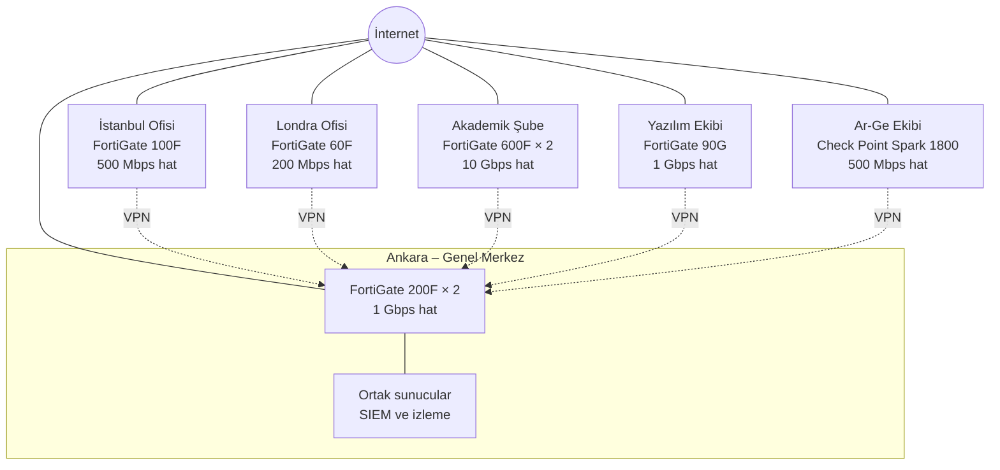
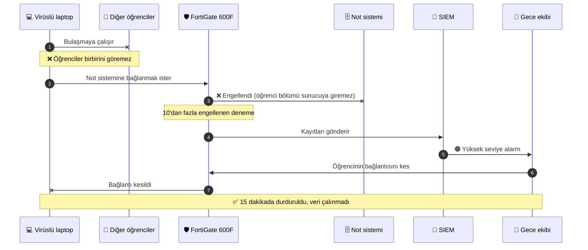
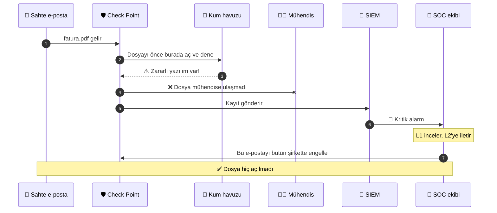
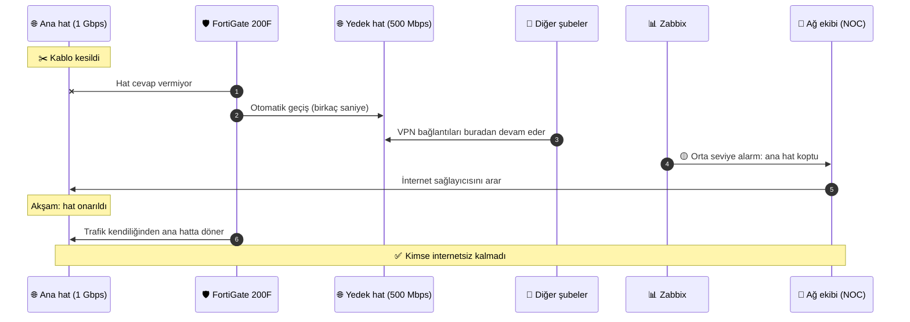

# Hayal A.Ş. — Ağ Güvenliği Planlaması

> Contributed by `Y*** Y***` ([@yusufiyilmaz](https://github.com/yusufiyilmaz)) · BGT207 Güvenlik Duvarı Çözümleri · 2026-2027 Güz midterm project.
> Student names are masked on purpose. Converted from the student's Turkish documents, which are kept in full below.

# Ağ Güvenliği Planlaması

Hayali bir şirket kuruyoruz ve bu şirketin tüm şubelerine adım adım güvenlik duvarı (firewall) kuruyoruz.

## İçindekiler

- [Güvenlik duvarı nedir?](#güvenlik-duvarı-nedir)
- [Bu projede ne yapıyoruz?](#bu-projede-ne-yapıyoruz)
- [Ağ şeması](#ağ-şeması)
- [Klasör yapısı](#klasör-yapısı)
- [Adım 1: Şirket yapısı](#adım-1-şirket-yapısı)
- [Adım 2: Bant genişliği](#adım-2-bant-genişliği)
- [Adım 3: Her şube için en iyi 5 güvenlik duvarı](#adım-3-her-şube-için-en-iyi-5-güvenlik-duvarı)
- [Adım 4: Adım adım kurulum](#adım-4-adım-adım-kurulum)
- [Adım 5: İzleme (monitoring)](#adım-5-i̇zleme-monitoring)
- [Durum](#durum)

Terimlerin açıklamaları için: [SOZLUK.md](SOZLUK.md)

## Güvenlik duvarı nedir?

Güvenlik duvarı, şirketin **kapısındaki bekçi** gibidir. İnternetten şirkete, şirketten internete giden her şeyi kontrol eder. Kimin girip çıkacağına verilen kurallara göre karar verir.

## Bu projede ne yapıyoruz?

Gerçek bir şirkette ağ güvenliğinden sorumlu kişi olsaydık şu sırayla düşünürdük:

| Adım | Soru | Neden? |
|------|------|--------|
| 1 | Şirkette kim var, kaç kişi var? | Kimi koruduğumuzu bilmeden koruyamayız |
| 2 | Bu insanlar ne kadar internet kullanır? | Bekçi, kapıdan geçen trafiği kaldırabilecek güçte olmalı |
| 3 | Hangi güvenlik duvarını seçelim? | Küçük şubeye küçük, büyük şubeye büyük cihaz |
| 4 | Nasıl kuralım? | Kurulumun bir sırası var, rastgele yapılmaz |
| 5 | Kim, nasıl izleyecek? | Saldırıyı birinin görmesi gerekir |
| 6 | Bekçiye hangi kuralları verelim? | Kimin girip kimin giremeyeceğini belirler |

## Şirket: Hayal A.Ş.

Hayal A.Ş. okullar ve şirketler için eğitim yazılımları geliştirir. Kendi akademik kampüsünü de işletir.

## Ağ şeması

Her şubenin kendi internet hattı ve kendi güvenlik duvarı var. Şubeler Ankara'daki merkeze internet üzerinden şifreli bağlantıyla (VPN, kesikli çizgiler) bağlanıyor.



## Klasör yapısı

```
ag-guvenligi-planlamasi/
├── README.md              → Projenin özeti (bu dosya)
├── KURULUM.md             → Her şubede ortak kurulum adımları
├── IZLEME.md              → İzleme: sistematik kısım ve insan kısmı
├── RISKLER.md             → Her şubede neyi, neden, nasıl koruyoruz
├── SENARYOLAR.md          → Sistemin gerçek olaylarda nasıl çalıştığı
├── SOZLUK.md              → Terimlerin açıklamaları
├── KAYNAKLAR.md           → Cihaz hızlarının kaynakları
│
├── 01-ankara-ofisi/
│   ├── README.md          → Kişi sayıları ve bant genişliği
│   ├── top5-firewall.md   → 5 aday güvenlik duvarı ve seçim
│   └── kurulum-adimlari.md→ Şubeye özel kurulum ve testler
├── 02-istanbul-ofisi/     → (aynı 3 dosya)
├── 03-londra-ofisi/
├── 04-akademik-sube/
├── 05-yazilim-ekibi/
└── 06-arge-ekibi/
```

## Adım 1: Şirket yapısı

**Bu adımda ne yaptık?** Şirketin hangi şubeleri olduğunu ve her şubede kaç kişi çalıştığını belirledik. Her şube için ayrı bir klasör açtık.

**Neden önemli?** Sonraki bütün adımlar bu sayılara dayanıyor. Kaç kişi olduğunu bilmeden ne kadar internet lazım olduğunu hesaplayamayız. İnterneti bilmeden de doğru büyüklükte güvenlik duvarı seçemeyiz.

| # | Şube | Konum | Personel | Hoca | Öğrenci | Yazılımcı | Teknik (BT) | Toplam |
|---|------|-------|---------:|-----:|--------:|----------:|------------:|-------:|
| 1 | Ankara Ofisi (Genel Merkez) | Ankara | 220 | - | - | - | 20 | 240 |
| 2 | İstanbul Ofisi | İstanbul | 110 | - | - | - | 10 | 120 |
| 3 | Londra Ofisi | Londra | 35 | - | - | - | 3 | 38 |
| 4 | Akademik Şube | İstanbul | 200 | 400 | 10.000 | - | 15 | 10.615 |
| 5 | Yazılım Ekibi | İstanbul | 5 | - | - | 60 | 5 | 70 |
| 6 | Ar-Ge Ekibi | Ankara | 3 | - | - | 22 | 3 | 28 |
| | **Toplam** | | **573** | **400** | **10.000** | **82** | **56** | **11.111** |

Her şubenin bilgileri kendi klasöründe.

## Sayıları nasıl belirledik?

Sayıları rastgele değil, her birini bir mantığa bağlayarak belirledik:

- **Öğrenci:** Akademik şubede 10.000 öğrenci var. Diğer sayıların çoğu buna göre hesaplandı.
- **Hoca:** Her 25 öğrenciye 1 hoca → 10.000 / 25 = 400
- **Akademik personel:** Her 50 öğrenciye 1 personel → 10.000 / 50 = 200
- **Ankara:** Genel merkez. Yönetim, insan kaynakları ve finans burada, bu yüzden en büyük ofis.
- **İstanbul:** Satış ofisi, Ankara'nın yaklaşık yarısı.
- **Londra:** Yurt dışı satış ofisi, küçük.
- **Yazılım ekibi:** İstanbul'da, çünkü yazılımcı bulmak orada daha kolay.
- **Ar-Ge ekibi:** Ankara'da ayrı bir binada. En gizli çalışmalar burada yapılıyor.
- **Teknik (BT):** Ofislerde her 10–15 çalışana 1 BT personeli. İki istisna var:
  - **Akademik şube:** 600 personel ve hocaya 15 BT personeli (40 kişiye 1). Öğrenciler kendi cihazlarını kendileri yönettiği için BT ekibi sadece kampüs ağı, laboratuvarlar ve personel bilgisayarlarıyla ilgileniyor.
  - **Ar-Ge:** 25 kişiye 3 BT personeli (8 kişiye 1). En gizli bilgiler burada ve kurallar en sıkı, bu yüzden BT desteği daha fazla.

## Adım 2: Bant genişliği

**Bant genişliği nedir?** Bir hattan aynı anda ne kadar veri geçebileceğidir. Bir yolun şerit sayısı gibi düşünülebilir: şerit ne kadar çoksa aynı anda o kadar araba geçer. Birimi **Mbps** (saniyede megabit). 1 Gbps = 1.000 Mbps.

**Bu adımda ne yaptık?** Her şubenin ne kadar internete ihtiyacı olduğunu hesapladık ve buna göre internet hattı seçtik.

**Neden önemli?** Güvenlik duvarı, internetten gelen her şeyin geçtiği kapıdır. Kapı hattan dar olursa her şey yavaşlar. Bu yüzden bir sonraki adımda cihaz seçerken bu hesabı kullanacağız.

### Nasıl hesapladık?

```
Gereken hız = Kişi sayısı × Kişi başı hız × Eşzamanlılık
İnternet hattı = Gereken hız × 1,25 → piyasada satılan bir üst hatta yuvarlanır
```

- **Kişi başı hız:** Yoğun saatte bir kişinin ortalama kullandığı internet.
- **Eşzamanlılık:** Aynı anda internette aktif olanların oranı. Herkes aynı anda video izlemez.
- **× 1,25 (yüzde 25 pay):** Ani yoğunluklar ve şirketin büyümesi için.

### Kim ne kadar kullanır?

| Kim? | Kişi başı | Eşzamanlılık | Neden? |
|------|----------:|-------------:|--------|
| Personel | 2 Mbps | %80 | E-posta, web, görüntülü toplantı. Mesai saatinde çoğu aktif |
| Teknik (BT) | 5 Mbps | %90 | Güncelleme indirme, uzaktan bağlantı, yedekleme |
| Yazılımcı | 10 Mbps | %90 | Büyük dosyalar indirir (kod, kütüphaneler, sanal sunucular) |
| Hoca | 3 Mbps | %60 | Online ders ve video |
| Öğrenci | 1 Mbps | %30 | 10.000 öğrencinin hepsi aynı anda kampüste ve internette olmaz |

### Örnek: Londra ofisi

```
Personel:    35 kişi × 2 Mbps × 0,80 = 56 Mbps
Teknik (BT):  3 kişi × 5 Mbps × 0,90 = 13,5 Mbps
Toplam                               ≈ 70 Mbps
Payla birlikte: 70 × 1,25            ≈ 87 Mbps → 200 Mbps hat
```

Diğer şubelerin hesabı kendi klasörlerinde.

### Özet

| Şube | Gereken | +%25 pay | Ana hat | Yedek hat |
|------|--------:|---------:|--------:|----------:|
| Ankara | 642 Mbps | 803 Mbps | 1 Gbps | 500 Mbps |
| İstanbul | 271 Mbps | 339 Mbps | 500 Mbps | 200 Mbps |
| Londra | 70 Mbps | 87 Mbps | 200 Mbps | 4G/5G modem |
| Akademik | 4.108 Mbps | 5.134 Mbps | 10 Gbps | 1 Gbps |
| Yazılım | 571 Mbps | 713 Mbps | 1 Gbps | 500 Mbps |
| Ar-Ge | 216 Mbps | 270 Mbps | 500 Mbps | 200 Mbps |

**Yedek hat nedir?** Farklı bir internet şirketinden alınan ikinci hat. Ana hat koparsa şube internetsiz kalmaz. Sadece arıza anında kullanıldığı için daha küçük seçildi.

### Ana hat koparsa ne olur?

Yedek hat küçük olduğu için çoğu şubede ihtiyacın tamamını karşılamıyor. Bu yüzden her şubede **önceliklendirme** yapılır: Hat yetmediğinde önemli trafik önce geçer, önemsiz olan yavaşlar veya kapanır.

| Şube | Yedek hat yeter mi? | Arıza anında ne olur? |
|------|---------------------|-----------------------|
| Ankara | Hayır (642 / 500 Mbps) | Şubelerin VPN bağlantıları ve sunucular önce geçer, toplantılar ve indirmeler yavaşlar |
| İstanbul | Hayır (271 / 200 Mbps) | Misafir Wi-Fi'ı kapanır |
| Londra | Kısmen (4G/5G) | Sadece e-posta ve VPN çalışır, video engellenir |
| Akademik | Hayır (4.108 / 1.000 Mbps) | Sadece hocalar, personel ve sınav sistemi internete çıkar. Öğrenci Wi-Fi'ı durur |
| Yazılım | Hemen hemen (571 / 500 Mbps) | Büyük indirmeler biraz yavaşlar |
| Ar-Ge | Hemen hemen (216 / 200 Mbps) | Büyük yedeklemeler geceye ertelenir |

Her şubenin öncelik sırası kendi klasöründe.

## Adım 3: Her şube için en iyi 5 güvenlik duvarı

**Bu adımda ne yaptık?** Her şube için piyasadaki 5 güvenlik duvarını karşılaştırdık, her birinin hızını yazdık ve içlerinden birini seçtik.

**Neden 5 aday?** Tek bir cihaz yazıp geçmek yerine seçenekleri karşılaştırmak, neden o cihazı seçtiğimizi gösteriyor. Bütçe değişirse 2. veya 3. aday kullanılabilir.

### Neye baktık?

**1. Tehdit koruma hızı (Threat Protection Throughput)**

Üreticiler kutunun üstüne büyük bir hız yazar (örneğin "27 Gbps"). Ama bu hız, güvenlik özellikleri **kapalıyken** ölçülür. Virüs tarama, saldırı engelleme (IPS) gibi özellikler açılınca cihaz yavaşlar. Biz bu özellikler **açıkken** ölçülen hıza, yani tehdit koruma hızına baktık. Gerçek hayatta cihaz böyle çalışacak.

**2. Kural: Cihazın hızı ≥ Ana hat**

Güvenlik duvarı, internet hattından yavaş olursa kapı daralır, darboğaz olur. Bu yüzden her şubede cihazın tehdit koruma hızı, ana internet hattına eşit ya da ondan büyük olmalı.

```
Örnek, Ankara:
Ana hat          ██████████                       1 Gbps
FortiGate 200F   ██████████████████████████████   3 Gbps  → hattan hızlı, uygun ✅
```

**3. Şubenin ihtiyacı:** Öğrenci girişi, misafir Wi-Fi, merkezden yönetim, şüpheli dosya testi gibi özellikler.

**4. Yedeklilik:** Büyük şubelerde (Ankara ve Akademik) 2 cihaz birlikte çalışır. Biri bozulursa diğeri devralır. Buna **HA (High Availability)** denir. **İki cihaz hızı ikiye katlamaz:** Biri çalışır, diğeri bekler. Bu yüzden hesap tek cihazın hızına göre yapıldı. Ankara'da 2 × 3 Gbps = 6 Gbps değil, yine 3 Gbps. Küçük şubelerde ikinci cihaz yerine Ankara'daki depoda **yedek cihaz** bekletilir: bir FortiGate ve Ar-Ge için bir Check Point. Cihaz bozulursa yedeği Türkiye'deki şubelere 1 gün içinde gönderilir. Ankara'dan Londra'ya gönderim gümrük yüzünden 2–3 gün sürer. Bu yüzden Londra için üreticinin **İngiltere'deki değişim hizmeti** kullanılır: bozuk cihazın yerine yenisi ertesi iş günü ofise getirilir.

### Seçimler

| Şube | Ana hat | Seçilen cihaz | Tehdit koruma hızı | Adet |
|------|--------:|---------------|-------------------:|-----:|
| Ankara | 1 Gbps | FortiGate 200F | 3 Gbps | 2 (HA) |
| İstanbul | 500 Mbps | FortiGate 100F | 1 Gbps | 1 |
| Londra | 200 Mbps | FortiGate 60F | 700 Mbps | 1 |
| Akademik | 10 Gbps | FortiGate 600F | 10,5 Gbps | 2 (HA) |
| Yazılım | 1 Gbps | FortiGate 90G | 2,2 Gbps | 1 |
| Ar-Ge | 500 Mbps | Check Point Quantum Spark 1800 | 2 Gbps | 1 |

Her şubenin 5 adayı kendi klasöründeki `top5-firewall.md` dosyasında. Hızların kaynakları [KAYNAKLAR.md](KAYNAKLAR.md) dosyasında.

### Neden çoğunlukla FortiGate?

- **Tek yerden yönetim:** Bütün FortiGate'ler Ankara'dan tek bir ekranla yönetilir. Londra'da sadece 3 BT personeli olduğu için bu çok önemli.
- **Şubeleri birbirine bağlamak kolay:** FortiGate'ler birbirine şifreli bağlantıyla (VPN) kolayca bağlanır.
- **Fiyat:** Aynı hız için genelde rakiplerinden daha ucuz.

### Ar-Ge neden farklı (Check Point)?

Şirketin en gizli bilgileri Ar-Ge'de. Her yerde aynı marka olursa, o markada bir güvenlik açığı çıktığında saldırgan her yere aynı yoldan girebilir. Ar-Ge'de farklı bir marka kullanınca saldırgan ikinci, farklı bir duvara takılır. Ayrıca Check Point şüpheli dosyaları açmadan önce güvenli bir ortamda deneyip test edebiliyor (kum havuzu / sandbox).

## Adım 4: Adım adım kurulum

**Bu adımda ne yaptık?** Seçtiğimiz güvenlik duvarlarının nasıl ve hangi sırayla kurulacağını yazdık.

**Neden önemli?** Kurulum rastgele yapılırsa bir şey unutulur ve açık kalır. Belli bir sırayla gidince her şey kontrol edilmiş olur.

İki yerde anlattık:
- **[KURULUM.md](KURULUM.md):** Her şubede aynı olan 13 adım ve şubelerin kurulum sırası.
- **Her şubenin `kurulum-adimlari.md` dosyası:** O şubenin bölümleri (VLAN), şubeye özel adımlar ve testler.

**Kurulum sırası:** Ankara → İstanbul → Londra → Yazılım → Ar-Ge → Akademik. Önce merkez kurulur, çünkü diğer şubeler ona bağlanacak. En büyük ve en riskli şube (Akademik) en sona, yarıyıl tatiline bırakılır.

**En önemli 3 fikir:**
1. **Önce cihazın kendisi korunur.** Saldırganın ilk denediği şey bekçinin kendisini ele geçirmektir.
2. **Ağ bölümlere ayrılır (VLAN).** Biri bir bölüme girse bile diğerlerine geçemez.
3. **Test edilmeden bitmiş sayılmaz.** Kablo çekip yedek hatta geçiyor mu, yasaklar gerçekten çalışıyor mu, denenir.

## Adım 5: İzleme (monitoring)

**Bu adımda ne yaptık?** Kurduğumuz güvenlik duvarlarını kimin, hangi araçlarla ve nasıl izleyeceğini yazdık.

**Neden önemli?** Güvenlik duvarı saldırıyı engeller ama bunu birinin görmesi gerekir. Kimse bakmazsa saldırgan aylarca denemeye devam edebilir.

Ayrıntılar [IZLEME.md](IZLEME.md) dosyasında. Özetle:

- **Sistematik kısım:** Bütün güvenlik duvarlarının kayıtları Ankara'da tek bir yerde (SIEM) toplanır. Yazılım şüpheli bir şey görünce alarm verir. Bazı alarmlara otomatik müdahale edilir.
- **İnsan kısmı:** Alarmlara güvenlik ekibi (SOC) bakar. Önce L1 analist inceler, ciddiyse L2'ye iletir. Gündüz şirketin kendi ekibi, gece dışarıdan bir güvenlik firması izler.
- **Profesyonel dünyada:** Olaylar NIST'in 4 aşamasıyla yönetilir: hazırlık, tespit, durdurma, ders çıkarma.

Her şubede neyi, neden ve nasıl koruduğumuzun toplu hâli: [RISKLER.md](RISKLER.md)

## Durum

1. [x] Şirket yapısı ve şube klasörleri
2. [x] Bant genişliği
3. [x] Her şube için en iyi 5 güvenlik duvarı
4. [x] Adım adım güvenlik duvarı kurulumu
5. [x] İzleme (monitoring)
6. [ ] Kural setleri (sonraki aşama)


---

# Güvenlik Duvarı Kurulumu

Bu dosyada **her şubede aynı olan** kurulum adımları var. Her şubeye özel kısımlar, şubenin klasöründeki `kurulum-adimlari.md` dosyasında.

## Hangi şube önce kurulur?

| Sıra | Şube | Neden? |
|-----:|------|--------|
| 1 | Ankara | Merkez. Diğer şubeler buraya bağlanacak ve buradan yönetilecek |
| 2 | İstanbul | Küçük ve basit. İlk deneme burada yapılır |
| 3 | Londra | İstanbul'da denenen yöntem burada tekrarlanır |
| 4 | Yazılım | Yazılımcıların araçları dikkatle test edilmeli |
| 5 | Ar-Ge | Farklı marka, ayrıca test gerekiyor |
| 6 | Akademik | En büyük ve en riskli şube. Önceki tecrübelerle, **yarıyıl tatilinde** kurulur |

## Ağı bölümlere ayırmak (VLAN)

**VLAN nedir?** Bir binadaki ağı, birbirini göremeyen bölümlere ayırmaktır. Bir apartmanın katları gibi düşünülebilir: herkes aynı binada ama kendi dairesinde. Bir bölümden diğerine geçmek isteyen her şey güvenlik duvarından geçer ve kurallara takılır.

**Neden?** Biri bir bilgisayarı ele geçirse bile sadece o bölümde kalır, diğer bölümlere geçemez.

Her şubede şu bölümler var:

| VLAN | Bölüm | Kimler? |
|-----:|-------|---------|
| 10 | BT | Teknik ekip |
| 20 | Çalışan | Personel |
| 80 | IoT | Kamera, yazıcı, kartlı giriş gibi cihazlar |
| 99 | Yönetim | Güvenlik duvarının ayar ekranı sadece buradan açılır |

**IoT neden ayrı?** Kamera ve yazıcıların yazılımları nadiren güncellenir, saldırganlar en çok bunları hedefler. Ayrı tutunca biri hacklense bile çalışanların bilgisayarlarına ulaşamaz.

Her şubeye ayrı bir adres bloğu verildi. Böylece bir IP adresine bakınca hangi şubeden geldiği hemen anlaşılır: Ankara `10.10.x.x`, İstanbul `10.20.x.x`, Londra `10.30.x.x`, Akademik `10.40.x.x` ve `10.41.x.x`, Yazılım `10.50.x.x`, Ar-Ge `10.60.x.x`.

## Kurulum adımları

### 1. Hazırlık
- Ağ planı, IP adresleri ve VLAN listesi hazırlanır.
- Kurulum için bir saat belirlenir (örneğin cumartesi gecesi) ve herkese önceden duyurulur.
- **Geri dönüş planı** yazılır: Bir şey ters giderse eski düzene nasıl dönülecek?

### 2. Cihazı yerleştirme ve kablolar
- Cihaz dolaba (kabin) takılır ve elektrik kesilince çalışmaya devam etsin diye **UPS'e** bağlanır.
- Kablolar: ana internet hattı, yedek internet hattı ve şirket içi ağ. İki cihazlı şubelerde iki cihaz birbirine de bağlanır.

### 3. Güncelleme ve isim
- Cihazın yazılımı (firmware) en güncel sürüme yükseltilir. Eski sürümlerde bilinen güvenlik açıkları olabilir.
- Cihaza bir isim verilir. Örnek: `FG-ANKARA-01` (marka-şube-sıra).

### 4. Önce cihazın kendisini korumak
Saldırganın ilk denediği şey, bekçinin kendisini ele geçirmektir. Bu yüzden:
- Fabrika çıkışı `admin` şifresi değiştirilir. Her BT personeline kendi adıyla hesap açılır.
- Girişte **iki adımlı doğrulama** (şifre + telefon kodu) zorunlu olur.
- Ayar ekranı internete kapatılır, sadece şirket içindeki yönetim bölümünden (VLAN 99) açılır.

### 5. Bölümleri (VLAN) oluşturmak
- Yukarıdaki VLAN'lar cihazda tanımlanır.
- Ağın çalışması için gereken temel servislere izin verilir. Güvenlik duvarında her şey yasak olduğu için bunlar unutulursa hiçbir şey çalışmaz:
  - **DHCP:** Bağlanan cihaza otomatik IP adresi verir.
  - **DNS:** `google.com` gibi site adlarını IP adresine çevirir.
  - **NTP:** Cihazların saatini eşitler. Saat yanlışsa kayıtlardaki zamanlar da yanlış olur.

### 6. İnternet hatları
- Ana hat ve yedek hat cihaza tanıtılır.
- Cihaz ana hattı sürekli kontrol eder. Hat koparsa **otomatik olarak** yedek hatta geçer, düzelince geri döner.

### 7. Güvenlik özelliklerini açmak

| Özellik | Ne yapar? |
|---------|-----------|
| **IPS** (saldırı önleme) | Bilinen saldırıları tanır ve engeller |
| **Antivirüs** | İndirilen dosyaları tarar |
| **Web filtresi** | Zararlı, kumar gibi siteleri engeller |
| **Uygulama kontrolü** | Torrent gibi istenmeyen uygulamaları tanır ve engeller |

### 8. Kurallar
Temel prensip: **Varsayılan olarak her şey yasak**, sadece gereken trafiğe tek tek izin verilir. Kural setleri sonraki aşamada yazılacak.

### 9. Ankara'ya şifreli bağlantı (VPN)
Her şube, Ankara'daki sunuculara internet üzerinden **şifreli bir tünelle** (VPN) bağlanır. Arada biri dinlese bile bir şey anlayamaz.

### 10. Yedekli çalışma (HA)
Sadece Ankara ve Akademik'te: İki cihazdan biri çalışır, diğeri bekler. Çalışan bozulursa bekleyen birkaç saniye içinde devralır.

### 11. Kayıtları merkeze göndermek
Cihazın kayıtları (log) Ankara'daki izleme sistemine gönderilir. Ayrıntısı 5. adımda (İzleme).

### 12. Test
Testler geçmeden kurulum bitmiş sayılmaz:
- [ ] Her bölümden internete çıkılabiliyor mu?
- [ ] Yasak olan bir şey gerçekten engelleniyor mu? (Örneğin çalışan bölümünden ayar ekranı açılmamalı)
- [ ] Ana hattın kablosu çekilince yedek hatta geçiliyor mu?
- [ ] Zararsız bir test virüsü (EICAR) indirilince antivirüs yakalıyor mu?
- [ ] Kayıtlar Ankara'ya ulaşıyor mu?

### 13. Yedek ve belgeleme
- Çalışan ayarların yedeği alınır.
- Ne yapıldığı yazılır: IP planı, kablolar, hesaplar.
- Bundan sonraki her değişiklik önce onaylanır, sonra yapılır ve kaydedilir.


---

# İzleme (Monitoring)

Güvenlik duvarını kurmak işin yarısıdır. Bir saldırı olduğunda, bir hat koptuğunda ya da biri ayarları değiştirdiğinde **bunu birinin fark etmesi** gerekir.

İzlemeyi iki kısma ayırdık:

| Kısım | Ne? | Benzetme |
|-------|-----|----------|
| **Sistematik kısım** | Kayıtları toplayan ve alarm veren yazılımlar | Binadaki güvenlik kameraları ve alarm sistemi |
| **İnsan kısmı** | Alarmlara bakan, karar veren ve müdahale eden ekip | Kamera ekranlarının başında oturan güvenlik görevlileri |

İkisi birbirine muhtaçtır. Yazılım olmazsa insanlar milyonlarca kayıt içinde kaybolur. İnsan olmazsa alarmlar kimse bakmadan birikir.

---

## 1. Sistematik kısım

### Nasıl çalışır?

```
Şubelerdeki güvenlik duvarları
            │  (kayıtlarını gönderir)
            ▼
   Ankara'daki SIEM  ──►  Alarm  ──►  Güvenlik ekibi (SOC)
   (kayıtları toplar,     (telefon, e-posta, mesaj)
    birleştirir, inceler)
```

1. Her güvenlik duvarı olan biten her şeyi **kayıt (log)** olarak yazar: kim, ne zaman, nereye bağlanmaya çalıştı, izin verildi mi, engellendi mi?
2. Bu kayıtlar Ankara'daki merkeze gönderilir.
3. Merkezdeki yazılım kayıtları inceler. Şüpheli bir şey görürse **alarm** verir.

### Kullandığımız araçlar

| Araç | Ne yapar? | Seçimimiz | Neden? |
|------|-----------|-----------|--------|
| **SIEM** | Bütün cihazlardan gelen kayıtları tek yerde toplar, birleştirir ve şüpheli durumda alarm verir | **Wazuh** | Ücretsiz. Her markadan kayıt alabiliyor (Ar-Ge'deki Check Point dahil) |
| **Performans izleme** | Hatların ne kadar dolu olduğunu, cihazların çalışıp çalışmadığını izler | **Zabbix** | Ücretsiz. Her marka cihazı izleyebiliyor |
| **Kayıt (ticket) sistemi** | Her alarmı bir kayda dönüştürür: kim baktı, ne yaptı, ne zaman bitti | **GLPI** | Ücretsiz. Hiçbir olay unutulmaz |

**SIEM neden önemli?** Tek bir yanlış şifre normaldir, herkes yanlış yazar. Ama aynı yerden 5 dakikada 10 yanlış şifre gelirse bu büyük ihtimalle bir saldırıdır. SIEM bu olayları birbirine bağlar ve tek bir alarm verir.

### Ne izleniyor?

| Ne? | Örnek alarm |
|-----|-------------|
| **Cihazlar çalışıyor mu?** | Akademik şubedeki güvenlik duvarı çok yoruldu (işlemci %90'ın üstünde) |
| **İnternet hatları** | İstanbul'un ana hattı koptu, yedek hatta geçildi |
| **Şubeler arası bağlantı (VPN)** | Londra ile Ankara arasındaki bağlantı 5 dakikadır kopuk |
| **Saldırılar** | Ar-Ge'de zararlı bir dosya yakalandı |
| **Ayar değişiklikleri** | Gece 03:00'te biri güvenlik duvarının ayarlarına girdi |

### Alarm seviyeleri

Her alarm aynı önemde değildir. Önemli olana hemen bakılır, önemsiz olan beklenebilir:

| Seviye | Örnek | Ne kadar sürede bakılır? |
|--------|-------|-------------------------:|
| 🔴 Kritik | Ar-Ge'deki sunucu izinsiz internete çıkmaya çalıştı | 15 dakika |
| 🟠 Yüksek | Aynı yerden 5 dakikada 10 yanlış şifre denendi | 1 saat |
| 🟡 Orta | İnternet hattı uzun süredir çok dolu | 4 saat |
| 🔵 Düşük | Güvenlik duvarı bilinen bir saldırıyı zaten engelledi | Ertesi gün |

**Otomatik müdahale:** Bazı alarmlarda insan beklenmez. Örneğin 10 kez yanlış şifre deneyen adres otomatik olarak 24 saat engellenir.

---

## 2. İnsan kısmı

### İki ekip: SOC ve NOC

Profesyonel dünyada izleme iki ekip tarafından yapılır:

| Ekip | Açılımı | Neye bakar? | Örnek soru |
|------|---------|-------------|------------|
| **SOC** | Güvenlik Operasyon Merkezi | Saldırılara | "Bu cihaz neden şirket ağını tarıyor?" |
| **NOC** | Ağ Operasyon Merkezi | Ağın çalışıp çalışmadığına | "İstanbul'un hattı neden koptu?" |

Bizde NOC işini Ankara'daki BT ekibi yapar. SOC için ayrı bir ekip kurulur.

### SOC'ta kim ne yapar?

Hastanedeki acil servis gibi çalışır: önce triyaj, sonra uzman.

| Kademe | Görevi | Kişi |
|--------|--------|-----:|
| **L1 – Analist** | Alarma ilk bakan kişi. Gerçek bir olay mı, yanlış alarm mı, buna karar verir. Ciddiyse L2'ye iletir | 4 |
| **L2 – Müdahale** | Olayı derinlemesine inceler ve saldırıyı durdurur | 2 |
| **L3 – Uzman** | Alarm gelmesini beklemeden saldırı izi arar. Yeni alarm kuralları yazar | 1 |
| **SOC yöneticisi** | Ekibi yönetir, yönetime rapor verir | 1 |

### 7/24 kim izliyor?

Saldırılar mesai saatinde gelmez. Ama gece de çalışan bir ekip kurmak çok pahalıdır: her vardiyada 1 kişi oturtmak için yaklaşık 5 kişi gerekir (vardiyalar, hafta sonları, izinler).

Bu yüzden **karma bir model** seçtik:

| Zaman | Kim izliyor? |
|-------|--------------|
| Hafta içi 08:00–24:00 | Şirketin kendi SOC ekibi |
| Gece ve hafta sonu | Dışarıdan hizmet alınan bir güvenlik firması |
| Kritik alarm, her zaman | Nöbetçi kişi telefonla aranır |

Türkiye'de orta büyüklükteki birçok şirket böyle çalışır.

### Bir olay olunca ne yapılır?

Profesyonel dünyada en çok kullanılan yöntem **NIST**'in (ABD Standartlar Enstitüsü) 4 aşamasıdır:

1. **Hazırlık:** Araçlar kurulu, ekip eğitimli, ne yapılacağı önceden yazılmış.
2. **Tespit:** Alarm geldi. Gerçek mi? Ne kadar ciddi?
3. **Durdurma ve temizleme:** Saldırıyı durdur, zararı temizle, sistemi normale döndür.
4. **Ders çıkarma:** Ne eksikti? Bir daha olmasın diye ne değiştirmeliyiz?

### Örnek: Bir öğrencinin cihazı şirket ağına girmeye çalışıyor

1. **Alarm gelir:** Aynı öğrenci cihazından şirket ağına 10'dan fazla engellenen bağlantı denemesi.
2. **L1 bakar:** Hangi öğrenci? (Öğrenciler internete numarasıyla girdiği için bu biliniyor.) Neye bağlanmaya çalışmış?
3. **L1 karar verir:**
   - Zararsız görünüyorsa (yanlış yazılmış bir adres gibi) kaydı kapatır.
   - Saldırı gibi görünüyorsa L2'ye iletir.
4. **L2 müdahale eder:** Öğrencinin Wi-Fi bağlantısını keser. Cihazda virüs mü var, yoksa öğrenci bilerek mi deniyor, araştırır.
5. **Sonuç:** Virüsse öğrenciden cihazını temizlemesi istenir. Bilerek yapıldıysa okul yönetimine bildirilir.
6. **Kayıt:** Yapılan her şey ticket sistemine yazılır.

Bu tür önceden yazılmış adım adım talimatlara **playbook** denir. Böylece gece 3'te alarma bakan yeni bir analist de ne yapacağını bilir.

---

## 3. Raporlama

| Rapor | Ne zaman? | Kime? | İçinde ne var? |
|-------|-----------|-------|----------------|
| Vardiya devri | Her vardiya sonunda | Sonraki vardiya | Açık kalan olaylar |
| Haftalık rapor | Haftada bir | BT yöneticisi | En çok engellenen saldırılar, hat kopmaları |
| Aylık rapor | Ayda bir | Şirket yönetimi | Kaç olay oldu, ne kadar sürede çözüldü |

**Başarıyı nasıl ölçeriz?**
- **Fark etme süresi:** Bir saldırı ortalama kaç dakikada fark edildi? Hedef: kritik olaylarda 15 dakikanın altı.
- **Müdahale süresi:** Fark edildikten sonra kaç dakikada müdahale edildi? Hedef: kritik olaylarda 1 saatin altı.
- **Yanlış alarm oranı:** Çok fazla yanlış alarm olursa ekip yorulur ve gerçek alarmları da kaçırmaya başlar. Hedef: %20'nin altı.

## 4. İzleme sistemi de test edilir

- **Ayda bir:** Bilerek 10 kez yanlış şifre denenir. Alarm geldi mi? Kaç dakikada? Doğru kişiye ulaştı mı?
- **Yılda bir:** Dışarıdan bir firmaya kontrollü saldırı (sızma testi) yaptırılır. SOC bunların ne kadarını fark etti?


---

# Riskler

Her şubede **neyi koruduğumuzu**, **neyden koruduğumuzu** ve **nasıl koruduğumuzu** tek tabloda topladık. Projede aldığımız kararların nedeni burada.

| Şube | Neyi koruyoruz? | Tehdit ne? | Nasıl önlüyoruz? |
|------|-----------------|------------|------------------|
| **Ankara** | Şirketin ortak sunucuları, personel ve maaş bilgileri | Saldırganın merkezi ele geçirip bütün şubelere ulaşması | 2 cihaz (HA), DMZ, yönetim ekranı internete kapalı, iki adımlı doğrulama |
| **Ankara** | Şirketin web sitesi | Web sitesi hacklenip iç ağa geçilmesi | Web sitesi DMZ'de, iç ağdan ayrı |
| **İstanbul** | Müşteri bilgileri | Misafir Wi-Fi'ından şirket ağına girilmesi | Misafir Wi-Fi'ı ayrı bölümde (VLAN), sadece internete çıkabiliyor |
| **Londra** | Avrupalı müşterilerin kişisel verileri | Verilerin taşınırken çalınması, UK GDPR ihlali | Ankara'ya şifreli bağlantı (VPN), verilere sadece yetkililer erişiyor |
| **Londra** | Ofisin internet bağlantısı | Ana hattın kopması | 4G/5G yedek hat |
| **Akademik** | Öğrenci notları ve kişisel bilgileri (KVKK) | Bir öğrencinin not sistemine girmeye çalışması | Öğrenci bölümü sunuculara sadece web sitesinden erişiyor, veritabanına erişemiyor |
| **Akademik** | Kampüsün interneti | Birkaç kişinin büyük dosya indirip hattı doldurması | Öğrenci başına 5 Mbps sınırı, torrent engeli |
| **Akademik** | Öğrenci cihazları | Virüslü bir öğrenci cihazının diğerlerine bulaşması | Wi-Fi'da öğrenciler birbirini göremiyor |
| **Akademik** | Yasal uyum | 5651 kayıtlarının tutulmaması | Öğrenciler numarasıyla giriş yapıyor, kayıtlar 2 yıl saklanıyor |
| **Yazılım** | Kaynak kod | Kodun kişisel hesaplara veya dışarıya gönderilmesi | Sadece şirketin GitHub hesabına izin, diğerleri engelli (DLP) |
| **Yazılım** | Gerçek müşteri verileri | Test sunucularından gerçek sistemlere erişilmesi | Test ve gerçek sunucular ayrı bölümlerde |
| **Ar-Ge** | Yeni ürün fikirleri, patentler | Diğer şubelerdeki bir açıkla Ar-Ge'ye ulaşılması | Farklı marka güvenlik duvarı (Check Point) |
| **Ar-Ge** | Proje dosyaları | Dosyaların buluta veya kişisel e-postaya gönderilmesi | Google Drive, Dropbox ve kişisel e-posta kapalı (DLP) |
| **Ar-Ge** | Ar-Ge bilgisayarları | Zararlı dosya indirilmesi | Her dosya önce kum havuzunda deneniyor |
| **Hepsi** | Kamera, yazıcı gibi cihazlar | Bu cihazlar hacklenip çalışanlara ulaşılması | IoT cihazları ayrı bölümde (VLAN 80), internete çıkamıyor |
| **Hepsi** | Güvenlik duvarının kendisi | Saldırganın güvenlik duvarını ele geçirmesi | Fabrika şifresi değişti, iki adımlı doğrulama, ayar ekranı sadece içeriden açılıyor |
| **Hepsi** | Bütün şirket | Bir saldırının kimse fark etmeden sürmesi | Kayıtlar merkezde toplanıyor, SOC ekibi 7/24 izliyor ([IZLEME.md](IZLEME.md)) |


---

# Senaryolar

Kurduğumuz sistemin gerçek bir olayda nasıl çalıştığını üç kısa hikâyeyle gösteriyoruz. Her adımın yanında, repodaki hangi karara dayandığı yazıyor.

---

## Senaryo 1: Virüslü öğrenci laptopu

**Gece 02:10.** Akademik şubede bir öğrencinin laptopuna, indirdiği korsan bir oyundan virüs bulaşmış. Virüs ağdaki diğer bilgisayarları aramaya başlıyor.



| Ne oldu? | Ne durdurdu? | Repoda nerede? |
|----------|--------------|----------------|
| Virüs diğer öğrencilerin cihazlarına bulaşmaya çalışıyor | Wi-Fi'da öğrenciler birbirini göremiyor | Akademik kurulum, 6. adım |
| Virüs not sisteminin sunucusuna bağlanmaya çalışıyor | Güvenlik duvarı engelliyor. Öğrenci bölümü (VLAN 70) sunuculara sadece web sitesinden erişebiliyor | Akademik kurulum, 5. adım |
| 10'dan fazla engellenen deneme oluyor | SIEM alarm veriyor (🟠 Yüksek) | IZLEME.md, alarm seviyeleri |
| Gece olduğu için şirketin ekibi yok | Dışarıdan hizmet alınan güvenlik firması alarmı görüyor ve öğrencinin Wi-Fi bağlantısını kesiyor | IZLEME.md, 7/24 kim izliyor? |
| Sabah: Bu cihaz kimin? | Öğrenciler internete numarasıyla girdiği için öğrenci biliniyor | Akademik kurulum, 2. ve 3. adım |

**Sonuç:** Virüs 15 dakikada durduruldu. Hiçbir sunucuya ulaşamadı, hiçbir veri çalınmadı. Öğrenciden cihazını temizlemesi istendi.

---

## Senaryo 2: Ar-Ge'ye gelen sahte e-posta

**Salı 10:30.** Ar-Ge'deki bir mühendise "fatura.pdf" ekli bir e-posta geliyor. Gönderen bir tedarikçi gibi görünüyor ama dosyanın içinde zararlı yazılım var. Amacı Ar-Ge'nin proje dosyalarını çalmak.



| Ne oldu? | Ne durdurdu? | Repoda nerede? |
|----------|--------------|----------------|
| Mühendis dosyayı açmak istiyor | Dosya, mühendise ulaşmadan önce kum havuzunda açılıp deneniyor. Zararlı olduğu anlaşılıyor ve engelleniyor | Ar-Ge kurulum, 4. adım |
| Saldırgan bu yöntemi FortiGate'li şubelerde daha önce denemiş olabilir | Ar-Ge'de farklı marka (Check Point) olduğu için başka bir duvara takılıyor | README, Adım 3 |
| Zararlı dosya yakalandı | SIEM alarm veriyor (🔴 Kritik) | IZLEME.md, alarm seviyeleri |
| Mesai saati | Şirketin kendi SOC ekibi bakıyor. L1 analist aynı e-postanın başka kimlere gittiğini kontrol ediyor ve L2'ye iletiyor | IZLEME.md, SOC'ta kim ne yapar? |
| Aynı e-posta başka şubelere de gitmiş mi? | L2, e-postayı bütün şirkette engelliyor ve çalışanları uyarıyor | IZLEME.md, NIST 3. aşama |

**Sonuç:** Dosya hiç açılmadı. Olaydan sonra bütün çalışanlara sahte e-postaları nasıl tanıyacaklarını anlatan kısa bir uyarı gönderildi (NIST 4. aşama: ders çıkarma).

---

## Senaryo 3: Ankara'nın internet hattı koptu

**Perşembe 14:00.** Ankara'nın yakınındaki bir yol çalışmasında iş makinesi fiber kabloyu kesiyor. Genel merkezin ana internet hattı kopuyor.



| Ne oldu? | Ne yaptı? | Repoda nerede? |
|----------|-----------|----------------|
| Ana hat (1 Gbps) koptu | Güvenlik duvarı birkaç saniye içinde fark ediyor ve **otomatik olarak** yedek hatta (500 Mbps) geçiyor | KURULUM.md, 6. adım |
| Diğer şubeler Ankara'daki sunuculara bağlanamaz mı? | Şubelerin VPN bağlantıları yedek hattan devam ediyor | İstanbul kurulum, 2. adım |
| Yedek hat ana hattan küçük | İnternet biraz yavaşlıyor ama kimse internetsiz kalmıyor | README, Adım 2 |
| Hat kopması | Performans izleme (Zabbix) alarm veriyor (🟡 Orta) | IZLEME.md, ne izleniyor? |
| Arıza | Ağ ekibi (NOC) internet sağlayıcısını arıyor ve arıza kaydı açtırıyor | IZLEME.md, SOC ve NOC |

**Sonuç:** Çalışanların çoğu kopmayı fark etmedi bile. Hat akşam onarıldı ve güvenlik duvarı trafiği kendiliğinden ana hatta geri aldı.

---

## Bu senaryolar ne gösteriyor?

Tek bir önlem her şeyi durdurmaz. Her senaryoda **birden fazla katman** devreye girdi: bölümler (VLAN), güvenlik duvarı, alarm sistemi ve onlara bakan insanlar. Biri kaçırsa bile diğeri yakalıyor. Profesyonel dünyada buna **katmanlı güvenlik (defense in depth)** denir.


---

# Sözlük

Projede geçen terimlerin kısa açıklamaları. Alfabetik sırayla.

| Terim | Açıklama |
|-------|----------|
| **5651 sayılı kanun** | Türkiye'de toplu internet hizmeti veren yerlerin (okul, kafe, şirket) kimin ne zaman bağlandığını kaydetmesini zorunlu kılan kanun |
| **Adres bloğu (/24, /16)** | Bir bölüme ayrılan IP adresi aralığı. `/24` yaklaşık 250, `/16` yaklaşık 65.000 adres demek |
| **Antivirüs** | İndirilen dosyaları tarayıp zararlı olanları engelleyen özellik |
| **Bant genişliği** | Bir hattan aynı anda geçebilecek veri miktarı. Yolun şerit sayısı gibi |
| **DHCP** | Ağa bağlanan cihaza otomatik olarak IP adresi veren servis |
| **DLP (veri sızıntısı koruması)** | Gizli dosyaların şirket dışına gönderilmesini engelleyen özellik |
| **DMZ** | İnternete açık sunucuların konduğu ayrı bölge. Burası hacklense bile iç ağa geçilemez |
| **DNS** | `google.com` gibi site adlarını IP adresine çeviren servis |
| **EICAR** | Antivirüs testinde kullanılan, zararsız ama virüs gibi algılanan test dosyası |
| **Eşzamanlılık** | Aynı anda internette aktif olan kişilerin oranı |
| **Firmware** | Cihazın içindeki yazılım. Güncellenmezse bilinen güvenlik açıkları kalır |
| **Giriş sayfası (captive portal)** | Wi-Fi'a bağlanınca açılan ve kullanıcı adı, şifre isteyen sayfa |
| **Güvenlik duvarı (firewall)** | Ağa giren ve çıkan trafiği kurallara göre kontrol eden cihaz. Şirketin kapısındaki bekçi |
| **HA (High Availability, yedekli çalışma)** | İki cihazın birlikte çalışması. Biri bozulursa diğeri birkaç saniyede devralır |
| **IoT** | İnternete bağlanan kamera, yazıcı, turnike gibi cihazlar |
| **IP adresi** | Ağdaki her cihazın adresi. Ev adresi gibi |
| **IPS (saldırı önleme)** | Bilinen saldırı kalıplarını tanıyıp engelleyen özellik |
| **KVKK** | Türkiye'nin kişisel verileri koruma kanunu |
| **Kum havuzu (sandbox)** | Şüpheli dosyanın, kullanıcıya ulaşmadan önce güvenli bir ortamda açılıp denendiği yer |
| **L1 / L2 / L3** | Güvenlik ekibindeki kademeler. L1 alarma ilk bakar, L2 müdahale eder, L3 uzmandır |
| **Log (kayıt)** | Cihazın olan biteni yazdığı kayıtlar: kim, ne zaman, nereye bağlandı |
| **Mbps / Gbps** | İnternet hızı birimi. 1 Gbps = 1.000 Mbps |
| **MFA (iki adımlı doğrulama)** | Şifreye ek olarak telefona gelen kod gibi ikinci bir doğrulama |
| **NIST** | ABD Standartlar Enstitüsü. Olaylara nasıl müdahale edileceğini anlatan yöntemi dünyada en çok kullanılan yöntemdir |
| **NOC** | Ağın çalışıp çalışmadığını izleyen ekip |
| **NTP** | Cihazların saatini eşitleyen servis |
| **Playbook** | Bir olay türü için önceden yazılmış adım adım müdahale talimatı |
| **SIEM** | Bütün cihazların kayıtlarını tek yerde toplayıp inceleyen ve alarm veren yazılım |
| **Sızma testi** | Bir firmanın, izin alarak şirkete kontrollü saldırı yapıp açıkları bulması |
| **SOC** | Güvenlik olaylarını izleyen ve müdahale eden ekip |
| **Tehdit koruma hızı** | Güvenlik duvarının, güvenlik özellikleri açıkken ulaşabildiği gerçek hız |
| **Ticket** | Her olay için açılan kayıt: kim baktı, ne yaptı, ne zaman bitti |
| **UK GDPR** | İngiltere'nin kişisel verileri koruma yasası |
| **Uygulama kontrolü** | Torrent gibi uygulamaları tanıyıp engelleyen özellik |
| **VLAN** | Bir ağı birbirini göremeyen bölümlere ayırmak. Apartmandaki daireler gibi |
| **VPN** | İnternet üzerinden kurulan şifreli bağlantı. Şubeleri Ankara'ya bağlar |
| **Web filtresi** | Zararlı, kumar gibi kategorilerdeki siteleri engelleyen özellik |
| **Yedek hat** | Farklı bir internet şirketinden alınan ikinci hat. Ana hat koparsa devreye girer |


---

# Kaynaklar

Hız değerleri üreticilerin teknik belgelerinden (datasheet) ve satıcı sayfalarından alındı (Ekim 2026).

**Dikkat:**
- Değerler yaklaşıktır. Her üretici ölçümü farklı koşullarda yapıyor (paket boyutu, açık olan özellikler, trafik türü).
- Aynı model için kaynaklarda farklı rakamlar olabiliyor. Bu durumda düşük olan değer kullanıldı.
- "~" ile yazılanlar, kesin resmi değer bulunamadığı için tahminidir.
- Gerçek satın alma öncesinde üreticinin güncel datasheet'i kontrol edilmeli.

| Üretici | Kaynak |
|---------|--------|
| Fortinet (FortiGate) | [Fortinet Product Matrix (2024)](https://www.boll-europe.at/datasheets/Fortinet_Product_Matrix.pdf), [Nomios – FortiGate modelleri](https://www.nomios.com/partners/fortinet/network-security/fortigate-firewall/entry-and-mid-range/), [SHI – FortiGate 600F](https://www.shi.com/product/44900362/Fortinet-FortiGate-600F), [datacenter360 – FortiGate 90G](https://datacenter360.ca/fortinet/fortigate/fortigate-90g-firewall/) |
| Palo Alto Networks | [Palo Alto – donanım güvenlik duvarı serileri](https://www.paloaltonetworks.com/resources/infographics/hwfw-upgrade) |
| Check Point | [Quantum Spark 1900/2000 datasheet](https://www.checkpoint.com/downloads/quantum-spark-1900-2000-datasheet.pdf), [Check Point cihaz karşılaştırması](https://www.checkpoint.com/check-point-security-appliances-comparison), [Quantum Force 9100](https://www.checkpoint.com/quantum/force/9100/), [Quantum Force 19100](https://www.checkpoint.com/quantum/force/19100/) |
| Cisco | [Secure Firewall 3100 datasheet](https://www.cisco.com/c/en/us/products/collateral/security/firewalls/secure-firewall-3100-series-ds.html) |
| Sophos | [Sophos XGS serisi](https://www.sophos.com/en-gb/products/next-gen-firewall/xgs-1u-distributed-edge-firewalls) |
| Netgate (pfSense) | [Netgate 6100](https://shop.netgate.com/products/6100-base-pfsense), [Suricata forumu – IPS açıkken hız düşüşü](https://forum.suricata.io/t/throughput-drop-on-netgate-8200-max-lan-vlan-ix1-with-suricata-inline-mode/6060) |


---

# Ankara Ofisi (Genel Merkez)

Şirketin yönetim merkezi. Yönetim, insan kaynakları ve finans burada.

| Rol | Sayı |
|-----|-----:|
| Personel | 220 |
| Teknik (BT) | 20 |
| **Toplam** | **240** |

## Bant genişliği

| Kim? | Kişi | Kişi başı | Eşzamanlılık | Gereken |
|------|-----:|----------:|-------------:|--------:|
| Personel | 220 | 2 Mbps | %80 | 352 Mbps |
| Teknik (BT) | 20 | 5 Mbps | %90 | 90 Mbps |
| Sunucu ve VPN trafiği | - | - | - | 200 Mbps |
| **Toplam** | | | | **642 Mbps** |

- **Payla birlikte:** 642 × 1,25 = 803 Mbps
- **Ana hat:** 1 Gbps
- **Yedek hat:** 500 Mbps

**Sunucu ve VPN trafiği neden var?** Şirketin ortak sunucuları (e-posta, dosya sunucusu) genel merkezde. Diğer şubeler bu sunuculara internet üzerinden şifreli bir bağlantıyla (VPN) bağlanıyor. Bu trafik de Ankara'nın hattından geçtiği için ayrıca ekledik.

**Ana hat koparsa yedek hat yeter mi?** Hayır. Gereken 642 Mbps, yedek hat 500 Mbps. Şubelerin VPN bağlantıları ve sunucu trafiği önce geçer. Görüntülü toplantılar ve büyük indirmeler yavaşlar.

**Önceliklendirme:** Hat yetmediğinde kim önce geçer?

1. Diğer şubelerin VPN bağlantıları ve ortak sunucular
2. Görüntülü toplantılar
3. Normal web


---

# Ankara Ofisi – En Uygun 5 Güvenlik Duvarı

**İhtiyaç:** 803 Mbps (ana hat 1 Gbps). Diğer 5 şubenin VPN bağlantıları burada sonlanıyor. Ortak sunucular burada.
**Kural:** Tehdit koruma hızı ≥ 1 Gbps. Cihazlar 2 adet, yedekli (HA) çalışacak.

| # | Cihaz | Tehdit koruma hızı | Neden bu sırada? |
|---|-------|-------------------:|------------------|
| 1 | **FortiGate 200F** | 3 Gbps | Diğer şubelerdeki FortiGate'lerle aynı ekrandan yönetilir. Bütün şubelerin bağlandığı merkez olmaya uygun. 1 Gbps hattın 3 katı hız, büyüme payı var |
| 2 | Palo Alto PA-1420 | 4,8 Gbps | Hangi uygulamanın kullanıldığını çok iyi tanır. Daha pahalı |
| 3 | Check Point Quantum Force 9100 | 4,95 Gbps | Kurumsal yönetim paneli çok gelişmiş. Lisans maliyeti yüksek |
| 4 | Cisco Secure Firewall 3105 | 10 Gbps | Çok güçlü, ağda Cisco switch varsa uyumlu. Bu şube için fazla büyük ve pahalı |
| 5 | Sophos XGS 2300 | 1,4 Gbps | Uygun fiyatlı, kullanımı kolay. 1 Gbps hatta yetiyor ama büyüme payı az |

## Bant genişliği karşılaştırması

```
Gereken (+%25 pay)  ████████                         803 Mbps
Ana hat             ██████████                       1 Gbps
FortiGate 200F      ██████████████████████████████   3 Gbps
```

## Seçim: FortiGate 200F (2 adet, HA)

- Genel merkez durursa tüm şirket durur. Bu yüzden 2 cihaz kullanılıyor, biri bozulursa diğeri saniyeler içinde devralır.
- Diğer şubelere de FortiGate konacağı için hepsi buradan, tek panelden yönetilebilir.


---

# Ankara Ofisi – Kurulum

Ortak adımlar: [KURULUM.md](../KURULUM.md). Burada sadece Ankara'ya özel olanlar var.

**Cihaz:** FortiGate 200F × 2 (biri çalışır, biri bekler)
**İsimler:** `FG-ANKARA-01`, `FG-ANKARA-02`
**Kurulum sırası:** 1. (ilk)

## Bölümler (VLAN)

| VLAN | Bölüm | Adres | Kimler? |
|-----:|-------|-------|---------|
| 10 | BT | 10.10.10.0/24 | 20 BT personeli |
| 20 | Çalışan | 10.10.20.0/24 | 220 personel |
| 30 | Sunucu | 10.10.30.0/24 | E-posta, dosya sunucusu, izleme sistemleri |
| 40 | DMZ | 10.10.40.0/24 | İnternete açık sunucular (şirket web sitesi) |
| 80 | IoT | 10.10.80.0/24 | Kamera, yazıcı, kartlı giriş |
| 99 | Yönetim | 10.10.99.0/24 | Cihazların ayar ekranları |

**DMZ nedir?** İnternetten herkesin erişebildiği sunucuların konduğu ayrı bölge. Web sitesi hacklenirse saldırgan DMZ'de kalır, şirketin iç ağına geçemez.

## Ankara'ya özel adımlar

1. **Merkezi yönetim:** Diğer şubelerdeki cihazları tek ekrandan yönetecek sistem burada kurulur.
2. **VPN merkezi:** Diğer 5 şubenin şifreli bağlantıları burada buluşur.
3. **DMZ:** Web sitesi DMZ'ye taşınır. İnternetten sadece web sitesine erişilebilir.
4. **Evden çalışma:** Evden bağlanan personel için VPN açılır. Girişte iki adımlı doğrulama zorunlu.

## Ankara'ya özel testler

- [ ] Diğer şubeler Ankara'daki sunuculara erişebiliyor mu?
- [ ] İnternetten web sitesine erişilebiliyor ama iç ağa erişilemiyor mu?
- [ ] `FG-ANKARA-01` kapatılınca `FG-ANKARA-02` devralıyor mu?


---

# İstanbul Ofisi

Satış ve operasyon ofisi. Müşterilerle burada çalışılır.

| Rol | Sayı |
|-----|-----:|
| Personel | 110 |
| Teknik (BT) | 10 |
| **Toplam** | **120** |

## Bant genişliği

| Kim? | Kişi | Kişi başı | Eşzamanlılık | Gereken |
|------|-----:|----------:|-------------:|--------:|
| Personel | 110 | 2 Mbps | %80 | 176 Mbps |
| Teknik (BT) | 10 | 5 Mbps | %90 | 45 Mbps |
| Misafir Wi-Fi | - | - | - | 50 Mbps |
| **Toplam** | | | | **271 Mbps** |

- **Payla birlikte:** 271 × 1,25 = 339 Mbps
- **Ana hat:** 500 Mbps
- **Yedek hat:** 200 Mbps

**Misafir Wi-Fi neden var?** Satış ofisine müşteriler geliyor. Misafir Wi-Fi'ı toplam 50 Mbps ile sınırlıyoruz, böylece misafirler çalışanların internetini yavaşlatamaz.

**Ana hat koparsa yedek hat yeter mi?** Hayır. Gereken 271 Mbps, yedek hat 200 Mbps. Misafir Wi-Fi'ı kapatılır. Ankara'ya VPN ve müşteri sistemi önce geçer.

**Önceliklendirme:** Hat yetmediğinde kim önce geçer?

1. Ankara'ya VPN ve müşteri sistemi
2. Görüntülü toplantılar
3. Normal web
4. Misafir Wi-Fi'ı


---

# İstanbul Ofisi – En Uygun 5 Güvenlik Duvarı

**İhtiyaç:** 339 Mbps (ana hat 500 Mbps). Misafir Wi-Fi'ı var. Ankara'ya VPN ile bağlanacak.
**Kural:** Tehdit koruma hızı ≥ 500 Mbps.

| # | Cihaz | Tehdit koruma hızı | Neden bu sırada? |
|---|-------|-------------------:|------------------|
| 1 | **FortiGate 100F** | 1 Gbps | Ankara'daki FortiGate ile aynı panelden yönetilir. Misafir Wi-Fi'ı ayrı ağa almak kolay |
| 2 | Sophos XGS 2100 | 1,25 Gbps | Uygun fiyatlı, arayüzü kolay. Ama Ankara'dan ayrı bir panelle yönetilmesi gerekir |
| 3 | Check Point Quantum Spark 1600 | 1,5 Gbps | Küçük ofisler için iyi. Lisans maliyeti yüksek |
| 4 | Palo Alto PA-440 | ~1 Gbps | Güvenlik çok iyi ama bu büyüklükte bir ofis için pahalı |
| 5 | pfSense (Netgate 6100) | ~1 Gbps (IPS açıkken, kurallara göre değişir) | Ücretsiz yazılım, ucuz donanım. Ama üretici desteği sınırlı ve BT ekibinin bilgisi önemli |

## Bant genişliği karşılaştırması

```
Gereken (+%25 pay)  ███████                          339 Mbps
Ana hat             ██████████                       500 Mbps
FortiGate 100F      ████████████████████             1 Gbps
```

## Seçim: FortiGate 100F (1 adet)

- Hattın 2 katı hızda, yani darboğaz olmaz.
- Cihaz bozulursa yedeği Ankara'dan 1 gün içinde gönderilebilir. Bu yüzden ikinci cihaz alınmadı.


---

# İstanbul Ofisi – Kurulum

Ortak adımlar: [KURULUM.md](../KURULUM.md). Burada sadece İstanbul'a özel olanlar var.

**Cihaz:** FortiGate 100F × 1
**İsim:** `FG-ISTANBUL-01`
**Kurulum sırası:** 2. (Ankara'dan sonraki ilk deneme)

## Bölümler (VLAN)

| VLAN | Bölüm | Adres | Kimler? |
|-----:|-------|-------|---------|
| 10 | BT | 10.20.10.0/24 | 10 BT personeli |
| 20 | Çalışan | 10.20.20.0/24 | 110 personel |
| 50 | Misafir | 10.20.50.0/24 | Misafir ve müşteri Wi-Fi'ı |
| 80 | IoT | 10.20.80.0/24 | Kamera, yazıcı, kartlı giriş |
| 99 | Yönetim | 10.20.99.0/24 | Cihazın ayar ekranı |

## İstanbul'a özel adımlar

1. **Misafir Wi-Fi'ı:** Misafirler sadece internete çıkabilir, şirket ağına giremez. Hızları toplam 50 Mbps ile sınırlı.
2. **Ankara'ya VPN:** Hem ana hem yedek hattan bağlantı kurulur.
3. **Deneme notları:** Kurulumda çıkan sorunlar not edilir, sonraki şubeler buna göre kurulur.

## İstanbul'a özel testler

- [ ] Misafir Wi-Fi'ından şirket ağına erişilemiyor mu?
- [ ] Misafir Wi-Fi'ı 50 Mbps'yi aşamıyor mu?


---

# Londra Ofisi

Yurt dışı satış ofisi. Küçük bir ekip.

| Rol | Sayı |
|-----|-----:|
| Personel | 35 |
| Teknik (BT) | 3 |
| **Toplam** | **38** |

## Bant genişliği

| Kim? | Kişi | Kişi başı | Eşzamanlılık | Gereken |
|------|-----:|----------:|-------------:|--------:|
| Personel | 35 | 2 Mbps | %80 | 56 Mbps |
| Teknik (BT) | 3 | 5 Mbps | %90 | 13,5 Mbps |
| **Toplam** | | | | **~70 Mbps** |

- **Payla birlikte:** 70 × 1,25 = 87 Mbps
- **Ana hat:** 200 Mbps
- **Yedek hat:** 4G/5G modem

**Neden 100 değil de 200 Mbps?** 87 Mbps, 100 Mbps'lik hatta neredeyse sınıra dayanır. Fiyat farkı da az.

**Yedek hat neden 4G/5G modem?** Ofis küçük. Arıza anında e-posta ve VPN çalışsın yeter. İkinci bir fiber hat bu ofis için pahalı olur.

**Ana hat koparsa yedek hat yeter mi?** Kısmen. 4G/5G modem 70 Mbps'yi her zaman veremez. Sadece e-posta ve Ankara'ya VPN çalışır. Mobil internet pahalı olduğu için video engellenir.

**Önceliklendirme:** Hat yetmediğinde kim önce geçer?

1. Ankara'ya VPN ve e-posta
2. Görüntülü toplantılar
3. Normal web


---

# Londra Ofisi – En Uygun 5 Güvenlik Duvarı

**İhtiyaç:** 87 Mbps (ana hat 200 Mbps). BT ekibi sadece 3 kişi. Ankara'dan uzaktan yönetilmeli.
**Kural:** Tehdit koruma hızı ≥ 200 Mbps.

| # | Cihaz | Tehdit koruma hızı | Neden bu sırada? |
|---|-------|-------------------:|------------------|
| 1 | **FortiGate 60F** | 700 Mbps | Ankara'dan uzaktan yönetilir. Küçük ve ucuz. Ana hat koparsa 4G/5G yedek hatta otomatik geçer |
| 2 | Check Point Quantum Spark 1600 | 1,5 Gbps | Küçük ofislerde yaygın. Ama ayrı panel ve pahalı lisans |
| 3 | Palo Alto PA-440 | ~1 Gbps | Çok güvenli ama 38 kişilik ofis için pahalı |
| 4 | Sophos XGS 2100 | 1,25 Gbps | Bu ofis için fazla büyük. Sophos'un daha küçük modelleri de kullanılabilir |
| 5 | pfSense (Netgate 6100) | ~1 Gbps (IPS açıkken, kurallara göre değişir) | Ucuz. Ama uzaktan yönetimi ve desteği diğerleri kadar kolay değil |

## Bant genişliği karşılaştırması

```
Gereken (+%25 pay)  ████                             87 Mbps
Ana hat             ██████████                       200 Mbps
FortiGate 60F       ███████████████████████████████  700 Mbps
```

## Seçim: FortiGate 60F (1 adet)

- Ankara'daki BT ekibi Londra'yı kendi ekranından yönetebilir, oraya gitmesine gerek kalmaz.
- Cihaz bozulursa Ankara'dan göndermek gümrük yüzünden 2–3 gün sürer. Bu yüzden üreticinin İngiltere'deki değişim hizmeti kullanılır, yeni cihaz ertesi iş günü gelir.
- Avrupa'daki müşteri verileri Türkiye'ye şifreli VPN ile taşınır. Bu UK GDPR açısından da önemli.


---

# Londra Ofisi – Kurulum

Ortak adımlar: [KURULUM.md](../KURULUM.md). Burada sadece Londra'ya özel olanlar var.

**Cihaz:** FortiGate 60F × 1
**İsim:** `FG-LONDRA-01`
**Kurulum sırası:** 3.

## Bölümler (VLAN)

| VLAN | Bölüm | Adres | Kimler? |
|-----:|-------|-------|---------|
| 10 | BT | 10.30.10.0/24 | 3 BT personeli |
| 20 | Çalışan | 10.30.20.0/24 | 35 personel |
| 50 | Misafir | 10.30.50.0/24 | Misafir Wi-Fi'ı |
| 80 | IoT | 10.30.80.0/24 | Kamera, yazıcı, kartlı giriş |
| 99 | Yönetim | 10.30.99.0/24 | Cihazın ayar ekranı |

## Londra'ya özel adımlar

1. **Uzaktan kurulum:** Cihazın ayarları Ankara'da önceden hazırlanır. Cihaz Londra'ya gönderilir, oradaki personel sadece kabloları takar. Cihaz internete bağlanınca ayarlarını Ankara'dan kendisi indirir. Kimsenin Londra'ya gitmesine gerek kalmaz.
2. **Yedek hat 4G/5G:** Ana hat koparsa sadece e-posta ve VPN yedek hattan geçer. Mobil internet pahalı olduğu için video engellenir.
3. **UK GDPR:** İngiltere'nin kişisel veri yasası. Müşteri verilerine sadece yetkili kişiler erişebilir.

## Londra'ya özel testler

- [ ] Ana hat kopunca 4G/5G'ye geçiliyor ve VPN çalışıyor mu?
- [ ] Ankara'daki BT ekibi cihazı uzaktan yönetebiliyor mu?


---

# Akademik Şube

Şirketin kampüsü. Öğrenciler, hocalar ve personel burada. En kalabalık şube.

| Rol | Sayı | Nasıl hesaplandı? |
|-----|-----:|-------------------|
| Öğrenci | 10.000 | Şubenin öğrenci kapasitesi |
| Hoca | 400 | 25 öğrenciye 1 hoca |
| Personel | 200 | 50 öğrenciye 1 personel |
| Teknik (BT) | 15 | Öğrenciler kendi cihazlarını yönetiyor. BT sadece kampüs ağı, laboratuvarlar ve personel bilgisayarlarıyla ilgileniyor |
| **Toplam** | **10.615** | |

**Neden önemli?** Şirketin toplam 11.111 kişisinin 10.615'i bu şubede. Bu yüzden en çok internet kullanan ve en çok korunması gereken şube burası.

## Bant genişliği

| Kim? | Kişi | Kişi başı | Eşzamanlılık | Gereken |
|------|-----:|----------:|-------------:|--------:|
| Öğrenci | 10.000 | 1 Mbps | %30 | 3.000 Mbps |
| Hoca | 400 | 3 Mbps | %60 | 720 Mbps |
| Personel | 200 | 2 Mbps | %80 | 320 Mbps |
| Teknik (BT) | 15 | 5 Mbps | %90 | 67,5 Mbps |
| **Toplam** | | | | **~4.108 Mbps** |

- **Payla birlikte:** 4.108 × 1,25 = 5.134 Mbps (yaklaşık 5 Gbps)
- **Ana hat:** 10 Gbps
- **Yedek hat:** 1 Gbps

**Neden öğrenci başı 1 Mbps?** Bu bir ortalama. Video izleyen öğrenci 5 Mbps kullanır, mesajlaşan neredeyse hiç kullanmaz.

**Neden %30?** 10.000 öğrencinin hepsi aynı anda kampüste değil. Dersler farklı saatlerde.

**Neden 10 Gbps?** 5 Gbps gerekiyor. Hatlar genelde 1 Gbps ve 10 Gbps olarak satılır, arası yok.

**Öğrenci sınırı:** Her öğrenci en fazla 5 Mbps kullanabilir. Böylece birkaç kişi büyük dosya indirerek bütün hattı dolduramaz.

**Ana hat koparsa yedek hat yeter mi?** Hayır. Gereken yaklaşık 4 Gbps, yedek hat 1 Gbps. Sadece hocalar, personel ve online sınav sistemi internete çıkar. Öğrenci Wi-Fi'ı ana hat düzelene kadar durur.

**Önceliklendirme:** Hat yetmediğinde kim önce geçer?

1. Online ders ve sınav sistemi
2. Hocalar ve personel
3. Öğrencilerin web trafiği
4. Diğer (oyun, büyük indirmeler)


---

# Akademik Şube – En Uygun 5 Güvenlik Duvarı

**İhtiyaç:** 5,1 Gbps (ana hat 10 Gbps). 10.000'den fazla kullanıcı, öğrencilerin kendi cihazları, 5651 sayılı kanuna göre kayıt tutma (Türkiye'de toplu internet veren yerler kimin ne zaman bağlandığını kaydetmek zorunda), öğrencilerin internete kimlikleriyle giriş yapması (captive portal).
**Kural:** Tehdit koruma hızı ≥ 10 Gbps. Cihazlar 2 adet, yedekli (HA) çalışacak.

| # | Cihaz | Tehdit koruma hızı | Neden bu sırada? |
|---|-------|-------------------:|------------------|
| 1 | **FortiGate 600F** | 10,5 Gbps | 10 Gbps hattı karşılıyor. Captive portal, kullanıcı başı hız sınırı ve kayıt tutma hazır geliyor. Diğer şubelerle aynı panel |
| 2 | Palo Alto PA-3440 | 12,8 Gbps | Daha hızlı ve uygulama tanıması çok iyi. Ama 2 cihaz alındığında maliyet çok artıyor |
| 3 | Sophos XGS 5500 | 12,4 Gbps | Hızlı ve görece ucuz. Eğitim kurumlarında yaygın |
| 4 | Cisco Secure Firewall 3120 | 21 Gbps | Çok güçlü, büyüme payı fazla. Yönetimi daha karmaşık ve pahalı |
| 5 | Check Point Quantum Force 19100 | 28,8 Gbps | En güçlü aday ama bu şube için fazla büyük ve en pahalısı |

## Bant genişliği karşılaştırması

```
Gereken (+%25 pay)  ██████████████                   5,1 Gbps
Ana hat             ███████████████████████████      10 Gbps
FortiGate 600F      ████████████████████████████     10,5 Gbps
```

## Seçim: FortiGate 600F (2 adet, HA)

- Şirketin en kalabalık şubesi. Güvenlik duvarı bozulursa 10.000 kişi internetsiz kalır, bu yüzden 2 cihaz kullanılıyor.
- Öğrenciler internete okul numarası ve şifreyle giriyor (captive portal). Böylece 5651 sayılı kanunun istediği "hangi kullanıcı, ne zaman, hangi IP" kaydı tutulabiliyor.

**Ücretsiz pfSense/OPNsense neden listede yok?** 10 Gbps hızda IPS çalıştırmak için çok güçlü bir sunucu gerekir. 10.000 kişilik bir şubede sorun çıktığında üreticiden 7/24 destek almak da önemli.


---

# Akademik Şube – Kurulum

Ortak adımlar: [KURULUM.md](../KURULUM.md). Burada sadece Akademik şubeye özel olanlar var.

**Cihaz:** FortiGate 600F × 2 (biri çalışır, biri bekler)
**İsimler:** `FG-AKADEMIK-01`, `FG-AKADEMIK-02`
**Kurulum sırası:** 6. (en son, yarıyıl tatilinde)

## Bölümler (VLAN)

| VLAN | Bölüm | Adres | Kimler? |
|-----:|-------|-------|---------|
| 10 | BT | 10.40.10.0/24 | 15 BT personeli |
| 20 | Personel | 10.40.20.0/24 | 200 personel |
| 30 | Hoca | 10.40.30.0/23 | 400 hoca |
| 50 | Laboratuvar | 10.40.50.0/24 | Bilgisayar laboratuvarları |
| 60 | Sunucu | 10.40.60.0/24 | Not sistemi, uzaktan eğitim sistemi |
| 70 | Öğrenci Wi-Fi | 10.41.0.0/16 | 10.000 öğrenci |
| 80 | IoT | 10.40.80.0/24 | Kamera, turnike, yazıcı |
| 99 | Yönetim | 10.40.99.0/24 | Cihazların ayar ekranları |

**Öğrenci bölümü neden bu kadar büyük?** Her öğrencinin telefon, laptop gibi 2–3 cihazı var. 10.000 öğrenci için 20.000–30.000 adres lazım. `/16` yaklaşık 65.000 adres verir.

## Akademik şubeye özel adımlar

1. **Neden yarıyıl tatilinde?** Dersler ve sınavlar aksamasın. Kampüs boşken sorunlar sakince çözülür.
2. **Öğrenci girişi:** Öğrenci Wi-Fi'a bağlanınca bir giriş sayfası açılır, öğrenci numarası ve şifresiyle girer. Böylece her bağlantının kime ait olduğu bilinir.
3. **5651 sayılı kanun:** "Hangi öğrenci, ne zaman, hangi adresi aldı" kayıtları en az 2 yıl saklanır.
4. **Hız sınırı:** Her öğrenci en fazla 5 Mbps kullanabilir.
5. **Öğrenciler not sistemine giremez:** Öğrenci bölümü, sunuculara sadece web sitesi üzerinden erişebilir. Veritabanına erişemez.
6. **Öğrenciler birbirini göremez:** Wi-Fi'da her öğrencinin cihazı diğerlerinden yalıtılır.

## Akademik şubeye özel testler

- [ ] Öğrenci numarası ve şifresiyle internete girilebiliyor mu?
- [ ] Giriş yapmamış cihaz internete çıkamıyor mu?
- [ ] Öğrenci Wi-Fi'ından not veritabanına erişilemiyor mu?
- [ ] Bir öğrenci 5 Mbps'yi aşamıyor mu?
- [ ] `FG-AKADEMIK-01` kapatılınca `FG-AKADEMIK-02` devralıyor mu?


---

# Yazılım Ekibi

Şirketin eğitim yazılımlarını geliştiren ekip. İstanbul'da.

| Rol | Sayı |
|-----|-----:|
| Yazılımcı | 60 |
| Personel | 5 |
| Teknik (BT) | 5 |
| **Toplam** | **70** |

## Bant genişliği

| Kim? | Kişi | Kişi başı | Eşzamanlılık | Gereken |
|------|-----:|----------:|-------------:|--------:|
| Yazılımcı | 60 | 10 Mbps | %90 | 540 Mbps |
| Personel | 5 | 2 Mbps | %80 | 8 Mbps |
| Teknik (BT) | 5 | 5 Mbps | %90 | 22,5 Mbps |
| **Toplam** | | | | **~571 Mbps** |

- **Payla birlikte:** 571 × 1,25 = 713 Mbps
- **Ana hat:** 1 Gbps
- **Yedek hat:** 500 Mbps

**Neden yazılımcı başı 10 Mbps?** Yazılımcılar gün içinde büyük dosyalar indirir ve gönderir: kod depoları, kütüphaneler, bulut sunuculara yüklemeler.

**Ana hat koparsa yedek hat yeter mi?** Hemen hemen. Gereken 571 Mbps, yedek hat 500 Mbps. Büyük indirmeler biraz yavaşlar, iş durmaz.

**Önceliklendirme:** Hat yetmediğinde kim önce geçer?

1. GitHub ve şirketin bulut sunucuları
2. Görüntülü toplantılar
3. Normal web


---

# Yazılım Ekibi – En Uygun 5 Güvenlik Duvarı

**İhtiyaç:** 713 Mbps (ana hat 1 Gbps). GitHub, paket depoları ve bulut sunuculara sorunsuz erişim. Kaynak kod dışarı sızmamalı.
**Kural:** Tehdit koruma hızı ≥ 1 Gbps.

| # | Cihaz | Tehdit koruma hızı | Neden bu sırada? |
|---|-------|-------------------:|------------------|
| 1 | **FortiGate 90G** | 2,2 Gbps | Hattın 2 katı hız. Diğer şubelerle aynı panel. Kaynak kodun dışarı gönderilmesini engelleyebiliyor (DLP) |
| 2 | Palo Alto PA-460 | 2,1 Gbps | Uygulama tanıması çok iyi. Örneğin GitHub'da "okumaya izin ver, başka hesaba yüklemeyi engelle" denebilir. Pahalı |
| 3 | Check Point Quantum Spark 1800 | 2 Gbps | Güvenli, hızı yeterli. Ayrı panel ve pahalı lisans |
| 4 | Sophos XGS 2300 | 1,4 Gbps | Uygun fiyatlı ama 1 Gbps hatta büyüme payı az |
| 5 | OPNsense (kendi sunucumuzda) | ~1 Gbps (IPS açıkken, donanıma göre değişir) | Ücretsiz. DevOps ekibi yönetebilir. Ama üretici desteği yok ve hız sınırda |

## Bant genişliği karşılaştırması

```
Gereken (+%25 pay)  ███████                          713 Mbps
Ana hat             ██████████                       1 Gbps
FortiGate 90G       ██████████████████████           2,2 Gbps
```

## Seçim: FortiGate 90G (1 adet)

- Yazılımcılar büyük dosyalar indiriyor. Güvenlik duvarı yavaş olursa iş durur, bu yüzden hattın 2 katı hızda bir cihaz seçildi.
- 2. sıradaki Palo Alto uygulama kontrolünde daha iyi. Bütçe yeterliyse o da tercih edilebilir.


---

# Yazılım Ekibi – Kurulum

Ortak adımlar: [KURULUM.md](../KURULUM.md). Burada sadece Yazılım ekibine özel olanlar var.

**Cihaz:** FortiGate 90G × 1
**İsim:** `FG-YAZILIM-01`
**Kurulum sırası:** 4.

## Bölümler (VLAN)

| VLAN | Bölüm | Adres | Kimler? |
|-----:|-------|-------|---------|
| 10 | BT | 10.50.10.0/24 | 5 BT personeli |
| 20 | Yazılımcı | 10.50.20.0/24 | 60 yazılımcı + 5 personel |
| 30 | Test sunucuları | 10.50.30.0/24 | Yazılımların denendiği sunucular |
| 80 | IoT | 10.50.80.0/24 | Kamera, yazıcı, kartlı giriş |
| 99 | Yönetim | 10.50.99.0/24 | Cihazın ayar ekranı |

## Yazılım ekibine özel adımlar

1. **İzinli siteler listesi:** Yazılımcıların ihtiyaç duyduğu siteler (GitHub, kütüphane depoları, şirketin bulut hesabı) listeye eklenir ve bunlara izin verilir.
2. **Kod sızıntısına karşı:** Şirketin GitHub hesabına kod gönderilebilir. Kişisel hesaplara ve dosya paylaşım sitelerine kod yüklemek engellenir.
3. **Test ve gerçek sistem ayrı:** Test sunucularından, gerçek müşteri verilerinin olduğu sunuculara erişilemez.

## Yazılım ekibine özel testler

- [ ] GitHub'dan kod indirme ve şirket hesabına gönderme çalışıyor mu?
- [ ] Kişisel bir GitHub hesabına kod göndermek engelleniyor mu?
- [ ] Test sunucularından gerçek sunuculara erişilemiyor mu?


---

# Ar-Ge Ekibi

Yeni ürünler üzerinde çalışan ekip. Ankara'da, diğer birimlerden ayrı bir binada. Şirketin en gizli çalışmaları burada.

| Rol | Sayı |
|-----|-----:|
| Mühendis / Yazılımcı | 22 |
| Personel | 3 |
| Teknik (BT) | 3 |
| **Toplam** | **28** |

**Neden ayrı binada?** Şirketin en değerli bilgileri (yeni ürün fikirleri, kaynak kod) burada. Başka bir şubeye saldırı olsa bile Ar-Ge'ye ulaşmak zor olsun diye ayrı tutuldu.

## Bant genişliği

| Kim? | Kişi | Kişi başı | Eşzamanlılık | Gereken |
|------|-----:|----------:|-------------:|--------:|
| Mühendis / Yazılımcı | 22 | 10 Mbps | %90 | 198 Mbps |
| Personel | 3 | 2 Mbps | %80 | 4,8 Mbps |
| Teknik (BT) | 3 | 5 Mbps | %90 | 13,5 Mbps |
| **Toplam** | | | | **~216 Mbps** |

- **Payla birlikte:** 216 × 1,25 = 270 Mbps
- **Ana hat:** 500 Mbps
- **Yedek hat:** 200 Mbps

**Neden 300 değil de 500 Mbps?** Ar-Ge'nin büyük deney ve tasarım dosyaları Ankara'daki sunuculara yedekleniyor. Bu yedeklemeler hattı zaman zaman dolduruyor.

**Ana hat koparsa yedek hat yeter mi?** Hemen hemen. Gereken 216 Mbps, yedek hat 200 Mbps. Ankara'ya yapılan büyük yedeklemeler geceye ertelenir.

**Önceliklendirme:** Hat yetmediğinde kim önce geçer?

1. Ankara'ya VPN (sunucular ve yedekleme)
2. Görüntülü toplantılar
3. İzin verilen siteler


---

# Ar-Ge Ekibi – En Uygun 5 Güvenlik Duvarı

**İhtiyaç:** 270 Mbps (ana hat 500 Mbps). Şirketin en gizli verileri burada. Hızdan çok güvenlik önemli.
**Kural:** Tehdit koruma hızı ≥ 500 Mbps. Kum havuzu (sandbox) ve veri sızıntısı koruması (DLP) olmalı.

| # | Cihaz | Tehdit koruma hızı | Neden bu sırada? |
|---|-------|-------------------:|------------------|
| 1 | **Check Point Quantum Spark 1800** | 2 Gbps | Diğer şubelerden farklı üretici. SandBlast kum havuzu şüpheli dosyaları açılmadan önce test ediyor |
| 2 | Palo Alto PA-440 | ~1 Gbps | WildFire kum havuzu çok iyi. O da farklı bir üretici olur |
| 3 | FortiGate 70F | 800 Mbps | Hızı yeterli ama diğer şubelerle aynı üretici olduğu için katmanlı güvenlik zayıflar |
| 4 | Sophos XGS 2100 | 1,25 Gbps | İyi ama kum havuzu ve DLP özellikleri ilk ikisi kadar güçlü değil |
| 5 | pfSense (Netgate 6100) | ~1 Gbps (IPS açıkken, kurallara göre değişir) | Ucuz ama kum havuzu ve DLP hazır gelmiyor. En gizli şube için uygun değil |

## Bant genişliği karşılaştırması

```
Gereken (+%25 pay)  ██                               270 Mbps
Ana hat             ████                             500 Mbps
Spark 1800          ████████████████                 2 Gbps
```

## Seçim: Check Point Quantum Spark 1800 (1 adet)

- **Katmanlı güvenlik (defense in depth):** Şirketin geri kalanında FortiGate var. FortiGate'te bir güvenlik açığı çıkarsa saldırgan Ar-Ge'ye aynı yoldan giremez, ikinci bir duvara takılır.
- **Yedek cihaz:** Ankara'daki depoda Ar-Ge için ayrıca bir Check Point bekletilir. Diğer şubelerin yedeği FortiGate olduğu için Ar-Ge'ye uymaz.
- Hız, gerekenin çok üstünde. Çünkü burada her trafik en sıkı şekilde (SSL denetimi, kum havuzu) kontrol edilecek ve bu da cihazı yavaşlatır.


---

# Ar-Ge Ekibi – Kurulum

Ortak adımlar: [KURULUM.md](../KURULUM.md). Burada sadece Ar-Ge'ye özel olanlar var.

**Cihaz:** Check Point Quantum Spark 1800 × 1
**İsim:** `CP-ARGE-01`
**Kurulum sırası:** 5.

## Bölümler (VLAN)

| VLAN | Bölüm | Adres | Kimler? |
|-----:|-------|-------|---------|
| 10 | BT | 10.60.10.0/24 | 3 BT personeli |
| 20 | Araştırmacı | 10.60.20.0/24 | 22 mühendis + 3 personel |
| 30 | Ar-Ge sunucuları | 10.60.30.0/24 | Proje dosyaları, deney verileri |
| 80 | IoT | 10.60.80.0/24 | Kamera, yazıcı, kartlı giriş |
| 99 | Yönetim | 10.60.99.0/24 | Cihazın ayar ekranı |

## Ar-Ge'ye özel adımlar

1. **Ayrı yönetim:** Farklı marka olduğu için diğer şubelerle aynı ekrandan yönetilmez. Sadece yetkili 2 kişi erişebilir.
2. **İki farklı marka arasında VPN:** Ankara'daki FortiGate ile bu cihazın şifreleme ayarları birebir aynı olmalı, yoksa bağlantı kurulmaz. Bu yüzden ayrıca test edilir.
3. **En sıkı kurallar:** İnternette sadece işle ilgili sitelere izin verilir, gerisi kapalı.
4. **Şüpheli dosya testi (kum havuzu):** İnternetten gelen her dosya, kullanıcıya ulaşmadan önce güvenli bir ortamda açılıp denenir. Zararlıysa engellenir.
5. **Dosya sızıntısına karşı:** Google Drive, Dropbox ve kişisel e-postaya dosya göndermek kapalı.

## Ar-Ge'ye özel testler

- [ ] Ankara'ya VPN bağlantısı kuruluyor mu?
- [ ] İzin listesinde olmayan bir site açılmıyor mu?
- [ ] Test virüsü (EICAR) kum havuzunda yakalanıyor mu?
- [ ] Google Drive'a dosya yüklemek engelleniyor mu?
